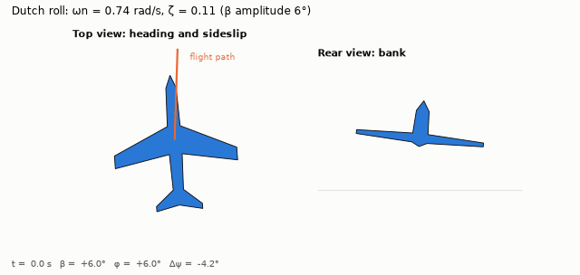
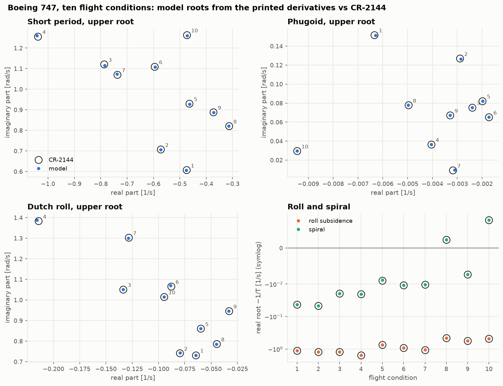
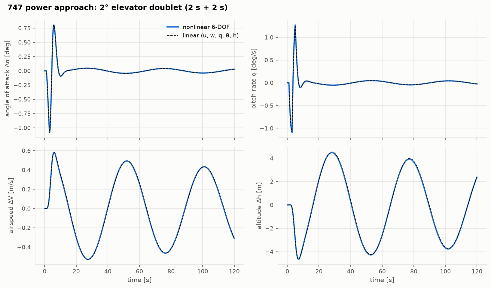

# Flight Dynamics From Scratch

[](https://github.com/GMCavalheri/flight-dynamics-from-scratch/actions/workflows/ci.yml)

Aircraft flight mechanics modelled from first principles in Python and NumPy:
- the nonlinear 6-DOF rigid-body equations of motion, with Euler angles or quaternions;
- a stability-derivative aerodynamic model, its axis transformations and dimensional
  derivatives;
- trim in level flight, climbs and coordinated turns;
- numerical and analytic linearization, and the classical modes — phugoid, short period,
  dutch roll, roll subsidence, spiral;
- nonlinear simulation of control inputs, with model-free mode identification;
- stability trade studies: CG position, tail size, and the spiral/dutch-roll balance.

No flight-dynamics libraries are used. Every module is verified against closed forms, and the
model is validated against published data for the **Boeing 747** (NASA CR-2144, ten flight
conditions from sea level to 40 000 ft) and the **Navion** (Teper 1969).

**New to the subject? Start with the [seven-lesson course](docs/lessons/README.md).**

<p align="center">
  
  
  
</p>

## What's inside

| Module | Method | Verified / validated against |
|---|---|---|
| [`equations_of_motion`](src/flightdyn/equations_of_motion) | body-axis Newton–Euler equations with $I_{xz}$, Euler angles and quaternions, implicit $\dot\alpha$ solved exactly | precession, ballistic parabola while tumbling, momentum and energy conservation |
| [`aero_derivatives`](src/flightdyn/aero_derivatives) | linear derivative model, stability↔body axes (CR-2144 App. B), dimensional and primed derivatives (App. A) | finite differences of the force model; **the 747's and Navion's own dimensional tables** |
| [`trim_solver`](src/flightdyn/trim_solver) | six accelerations + sideslip/bank constraint, flight-path and turn kinematics | independent wind-axis solution, inertial turn balance, a simulation that stays put |
| [`linearization`](src/flightdyn/linearization), [`modal_analysis`](src/flightdyn/modal_analysis) | numerical Jacobians, CR-2144 App. C small-perturbation models, mode classification, mode shapes, approximations | analytic = numerical to 1e-8; **published roots of the 747 (10 conditions) and Navion** |
| [`nonlinear_sim`](src/flightdyn/nonlinear_sim) | piecewise DOP853 between input breakpoints, matrix-pencil identification | matrix exponential; error order a² / a³; identified = linear poles to 0.1 % |
| [`trade_studies`](src/flightdyn/trade_studies) | exact CG transfer, neutral point, calibrated tail, scissors diagram, lateral map | rigid-body transfer to second order; spiral criterion |

## Headline results

| Benchmark | Result |
|---|---|
| Navion: printed derivatives → roots, vs Teper | every printed digit (≤ 0.11 %) |
| Boeing 747: printed derivatives → roots, vs CR-2144, ten flight conditions | ≤ 1.2 % (two cases inside their rounding band) |
| Boeing 747: nondimensional data → dimensional derivatives, vs CR-2144 | ≤ 0.65 % (one documented exception) |
| Nonlinear flight: poles read from time histories vs linear eigenvalues | ≤ 0.08 % |
| 747 neutral point / static margin at the published CG | 0.470 MAC / 22 % |

Checking the reports against themselves also found things the reports do not say: the 747's
lateral derivatives are stability-axis; its data is trimmed with the thrust moment; its
published roots include terms its appendix says are neglected; and the Navion's dimensional
table used a wing area of 184 ft², not the 180 ft² printed. The full comparison, figures and
discussion are in the **[validation report](docs/validation-report.md)**.

## Quickstart

Requires [uv](https://docs.astral.sh/uv/).

```bash
uv sync
uv run pytest
```

```python
import sys

sys.path.insert(0, "validation")  # the cited reference aircraft
from reference_aircraft import b747, b747_condition

from flightdyn.linearization import lateral, linearize, longitudinal
from flightdyn.modal_analysis import lateral_modes, longitudinal_modes
from flightdyn.nonlinear_sim import Doublet, simulate
from flightdyn.trim_solver import trim

ac, c = b747(2), b747_condition(2)  # Boeing 747, power approach, NASA CR-2144
t = trim(ac, c["V"], c["h"])
lm = linearize(ac, t)
modes = longitudinal_modes(longitudinal(lm).A) | lateral_modes(lateral(lm, c["V"]).A)
print({name: round(m.wn, 3) for name, m in modes.items()})
# {'phugoid': 0.126, 'short_period': 0.908, 'spiral': 0.047, 'roll': 1.225, 'dutch_roll': 0.745}

r = simulate(ac, t.x, t.controls, [Doublet("de", 0.02, start=1.0, width=2.0)], t_end=60.0)
```

## Repository layout

```
src/flightdyn/      the package: one subpackage per module above
tests/              pytest, one file per module (plus the docs' math rendering)
validation/         scripts, cited reference data and results; run_all.py regenerates all
docs/               theory notes, validation report, figures, and the lesson course
notebooks/          executed demo notebooks, generated by build_notebooks.py
```

## Related projects

Part of a series on the classical pillars of aerospace engineering, each from first
principles: [aerodynamics](https://github.com/GMCavalheri/aerodynamics-from-scratch) (whose
vortex-lattice solver is used for an optional cross-check here),
[aircraft structures](https://github.com/GMCavalheri/aircraft-structures-from-scratch) and
[propulsion](https://github.com/GMCavalheri/propulsion-from-scratch).

## Data sources

- R. K. Heffley & W. F. Jewell, *Aircraft Handling Qualities Data*, NASA CR-2144, 1972
  (NTRS 19730003312), Section IX and Appendices A–C.
- G. L. Teper, *Aircraft Stability and Control Data*, STI TR-176-1, 1969 (NTRS 19690022405),
  Section X.
- *US Standard Atmosphere*, 1976.

## License

MIT. See [LICENSE](LICENSE).
