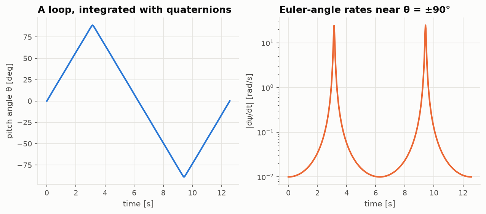
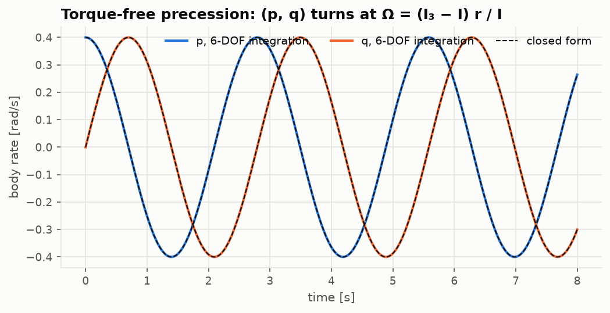

# Lesson 1 · The equations of motion of a rigid aircraft

> *An aircraft in flight is a rigid body pushed around by gravity, aerodynamics and thrust.
> Before we can ask whether it is stable, we need the twelve differential equations that say
> how it moves. They come from Newton's second law, written in axes that rotate with the
> aircraft.*

**Code:** [`src/flightdyn/equations_of_motion/`](../../src/flightdyn/equations_of_motion),
[`rotations.py`](../../src/flightdyn/rotations.py) ·
**Notebook:** [`01_equations_of_motion.ipynb`](../../notebooks/01_equations_of_motion.ipynb) ·
**Next:** [Lesson 2 — Aerodynamic derivatives](02-aerodynamic-derivatives.md)

## Learning objectives

By the end of this lesson you should be able to

1. define the Earth (NED), body and stability axes and the angles that relate them;
2. derive the force and moment equations of a rigid body in rotating body axes, including the
   product of inertia $I_{xz}$;
3. write the kinematic equations for Euler angles and quaternions, and explain gimbal lock;
4. assemble the twelve-state nonlinear model and list the assumptions behind it;
5. verify a 6-DOF integrator against closed-form rigid-body motions.

---

## 1. Axes

Three frames carry the whole subject.

| Frame | Origin | Axes | Used for |
|---|---|---|---|
| Earth (NED) | a point on the ground | x north, y east, z down | position, gravity |
| Body | centre of gravity | x forward along the fuselage, y out the right wing, z down | inertia, forces, rates |
| Stability | centre of gravity | body axes rotated by the trim angle of attack $\alpha_0$ about y | stability derivatives (Lesson 2) |

The body frame is fixed to the aircraft, so the inertia tensor is constant in it. That is why
we write the dynamics there, even though Newton's law holds only in an inertial frame. For
flight dynamics of an aeroplane (not a spacecraft or a hypersonic vehicle), the Earth can be
taken as flat and non-rotating. The errors are of order $\Omega_{E} V/g$, about 0.1 % for an
airliner.

The body velocity relative to the air is $\mathbf v = (u, v, w)$ and the body angular velocity is
$\boldsymbol\omega = (p, q, r)$: roll, pitch and yaw rate. The aerodynamic angles follow from the
velocity:

```math
V = \sqrt{u^2 + v^2 + w^2}, \qquad \alpha = \arctan\frac{w}{u}, \qquad \beta = \arcsin\frac{v}{V}
```

## 2. Attitude: Euler angles

The aerospace convention reaches body axes from NED by three successive rotations: yaw ψ
about z, then pitch θ about the new y, then roll φ about the new x (a 3-2-1 sequence). The
direction cosine matrix is the product of the three elementary rotations,

```math
\mathbf C_{b \leftarrow n} = \mathbf R_1(\phi)\,\mathbf R_2(\theta)\,\mathbf R_3(\psi)
```

and its third column gives gravity in body axes:

```math
\mathbf g_b = \mathbf C_{b \leftarrow n} \begin{pmatrix}0\\0\\g\end{pmatrix} = g\begin{pmatrix}-\sin\theta\\ \cos\theta\sin\phi\\ \cos\theta\cos\phi\end{pmatrix}
```

Heading does not appear: on a flat Earth, gravity does not care which way you point.

The Euler angles are not the integrals of p, q, r. The rates are measured about axes that
move with each rotation, and inverting the rotation chain gives

```math
\begin{aligned}
\dot\phi &= p + (q\sin\phi + r\cos\phi)\tan\theta \\
\dot\theta &= q\cos\phi - r\sin\phi \\
\dot\psi &= (q\sin\phi + r\cos\phi)/\cos\theta
\end{aligned}
```

## 3. Gimbal lock and quaternions

At θ = ±90° the first and third rotations are about the same axis, so φ and ψ are no longer
separately defined. In the equations above, $\tan\theta$ and $1/\cos\theta$ blow up. This is
**gimbal lock**: not a physical event, only a failure of the coordinates.



The figure flies a loop at constant pitch rate with a tiny yaw rate. Integrated with
quaternions, nothing happens at the top. Converted to Euler angles, the yaw rate needed to
describe the same motion jumps by two orders of magnitude as θ approaches 90°. An integrator
working in Euler angles would have to take tiny steps there, and exactly at 90° it would fail.

A unit quaternion $\mathbf q = (q_0, q_1, q_2, q_3)$ has no singularity. Its kinematics are linear
in the rates:

```math
\dot{\mathbf q} = \frac12\begin{pmatrix}0 & -p & -q & -r\\ p & 0 & r & -q\\ q & -r & 0 & p\\ r & q & -p & 0\end{pmatrix}\mathbf q + k\left(1 - \lVert\mathbf q\rVert^2\right)\mathbf q
```

The last term is not physics. Numerical integration slowly drifts the quaternion off the unit
sphere, and this term pulls it back (Stevens, Lewis & Johnson, ch. 1). On the sphere it is
exactly zero. The code offers both forms: Euler angles are what pilots and textbooks use, and
are fine away from vertical flight; quaternions are used for aerobatics and simulators.

## 4. Translational dynamics

Newton's law applies to the inertial derivative of momentum. Expressed in rotating body axes,
any vector's inertial derivative picks up a transport term $\boldsymbol\omega \times$:

```math
m\left(\dot{\mathbf v} + \boldsymbol\omega \times \mathbf v\right) = \mathbf F + m\,\mathbf g_b
```

where $\mathbf F$ is the aerodynamic and propulsive force. Written out,

```math
\begin{aligned}
\dot u &= rv - qw - g\sin\theta + X/m \\
\dot v &= pw - ru + g\cos\theta\sin\phi + Y/m \\
\dot w &= qu - pv + g\cos\theta\cos\phi + Z/m
\end{aligned}
```

The $rv - qw$ terms are not forces. They are the price of measuring velocity in a turning
frame. In a steady pull-up at rate q with u = V, the second line of the matrix gives
$\dot w = qV + \ldots$: the lift that keeps $\dot w = 0$ must supply the centripetal
acceleration $qV$. This is where load factor comes from.

## 5. Rotational dynamics

The same transport theorem applied to angular momentum $\mathbf h = \mathbf I\boldsymbol\omega$ gives
Euler's equations:

```math
\mathbf I\dot{\boldsymbol\omega} + \boldsymbol\omega \times \mathbf I\boldsymbol\omega = \mathbf M,
\qquad
\mathbf I = \begin{pmatrix}I_{xx} & 0 & -I_{xz}\\ 0 & I_{yy} & 0\\ -I_{xz} & 0 & I_{zz}\end{pmatrix}
```

The aircraft is symmetric about its x-z plane, so two products of inertia vanish. The third,
$I_{xz} = \int xz dm$, does not: the body x axis is generally not a principal axis. Its
effect is to couple roll and yaw even in the inertia:

```math
\begin{aligned}
I_{xx}\dot p - I_{xz}\dot r &= L + (I_{yy} - I_{zz})qr + I_{xz}pq \\
I_{yy}\dot q &= M + (I_{zz} - I_{xx})pr + I_{xz}(r^2 - p^2) \\
I_{zz}\dot r - I_{xz}\dot p &= N + (I_{xx} - I_{yy})pq - I_{xz}qr
\end{aligned}
```

A pure rolling moment L therefore produces a yaw acceleration $\dot r = I_{xz}L/(I_{xx}I_{zz} - I_{xz}^2)$.
For the Boeing 747 in the reference data, $I_{xz}/I_{xx}$ is 5–6 %. Lesson 2 shows how the
textbooks hide this coupling inside the "primed" derivatives $L'$ and $N'$.

## 6. Navigation

Position comes from rotating the body velocity back to Earth axes:

```math
\dot{\mathbf r}_{NED} = \mathbf C_{b \leftarrow n}^{T}\,\mathbf v
```

Altitude is $h = -z_{d}$. Together, sections 2–6 are twelve first-order ODEs:

| States | Equation | Count |
|---|---|---|
| u, v, w | force equations | 3 |
| p, q, r | moment equations | 3 |
| φ, θ, ψ | Euler kinematics (or 4 quaternion states) | 3 |
| x_n, y_e, z_d | navigation | 3 |

In code, [`rigid_body_derivative`](../../src/flightdyn/equations_of_motion/rigid_body.py) takes
the state, the body-axis force and moment (without gravity) and the mass properties, and
returns the derivative:

```python
import numpy as np

from flightdyn.aircraft import MassProperties
from flightdyn.equations_of_motion import rigid_body_derivative

mp = MassProperties(mass=1200.0, Ixx=1400.0, Iyy=4000.0, Izz=4800.0, Ixz=250.0)
x = np.zeros(12)
x[0] = 60.0  # u = 60 m/s, level, wings level
lift = (0.0, 0.0, -mp.mass * 9.80665)  # lift balances weight
print(rigid_body_derivative(x, lift, (0.0, 0.0, 0.0), mp))
# [ 0.  0.  0.  0.  0.  0.  0.  0.  0. 60.  0.  0.]  -> only x_n changes
```

Everything aircraft-specific — aerodynamics, engines, controls — lives in the force and
moment. The rigid body does not know it is an aeroplane.

## 7. Verifying the integrator

Before any aerodynamics, the rigid body must reproduce motions whose answers are known in
closed form. The tests in [`tests/test_equations_of_motion.py`](../../tests/test_equations_of_motion.py)
check:

| Case | Closed form | Checks |
|---|---|---|
| Constant pitching moment, no gravity | $q = Mt/I_{yy}$, $\theta = Mt^2/(2I_{yy})$ | moment equation, kinematics |
| Ballistic flight while tumbling | CG follows a parabola in NED | gravity, rotation, navigation together |
| Torque-free axisymmetric body | $(p, q)$ rotates at $\Omega = (I_3 - I)r/I$ | gyroscopic terms |
| Torque-free body with $I_{xz}$ | $\mathbf h_{NED}$ and kinetic energy constant | full Euler equations |
| Gravity only | kinetic minus potential energy constant | force equations |
| Euler vs quaternion | same trajectory | both kinematics |



The precession case is the classic one. With $I = 2$, $I_3 = 5$ and $r = 1.5$ rad/s, the
transverse rate vector turns at $\Omega = 2.25$ rad/s. The integrated $(p, q)$ lie on the
dashed closed form to $10^{-9}$. The ballistic case is stronger than it looks: the body spins
and nutates, the velocity components swing between axes, and yet the centre of gravity must
trace the same parabola as a thrown stone. Any sign error in the $\boldsymbol\omega \times \mathbf v$
terms or the direction cosine matrix breaks it.

## 8. Common pitfalls

- **Integrating p, q, r to get φ, θ, ψ.** Only true for small angles and rates. Use the
  kinematic equations.
- **Dropping $I_{xz}$.** It is not small for most aircraft, and its sign depends on where
  the body x axis is drawn relative to the principal axis.
- **Forgetting the transport terms.** $\dot u = X/m$ is the inertial-frame law. In body axes,
  the $rv - qw$ terms are essential.
- **Sign of z.** Body and Earth z axes point *down*. Altitude is $-z_{d}$, and lift is a
  negative Z force.

## 9. Exercises

1. Show that in steady level flight ($\phi = \theta = 0$, $\boldsymbol\omega = 0$, $u = V$)
   the force equations reduce to $X = 0$, $Y = 0$, $Z = -mg$.
2. An aircraft flies a steady pull-up at $V$ = 100 m/s and $q$ = 0.1 rad/s with $\theta$ = 0
   at the bottom. Find the load factor $n = -Z/(mg)$.
3. Starting from $\mathbf I\dot{\boldsymbol\omega} + \boldsymbol\omega \times \mathbf I\boldsymbol\omega = \mathbf M$,
   derive the roll and yaw equations above, including the $I_{xz}$ terms.
4. For the torque-free axisymmetric body, show that $p^2 + q^2$ is constant and find the
   precession rate.
5. Show that the quaternion kinematics preserve $\lVert\mathbf q\rVert$ when $k = 0$.

<details>
<summary>Answers</summary>

1. With all rates and angles zero, $\dot u = X/m$, $\dot v = Y/m$, $\dot w = g + Z/m$. Setting
   them to zero gives the result: lift equals weight, thrust equals drag.
2. $\dot w = qu + g + Z/m = 0$ gives $-Z = m(g + qV)$, so $n = 1 + qV/g$ = 1 + 10/9.807 = 2.02.
3. Expand $\boldsymbol\omega \times \mathbf I\boldsymbol\omega$ with the tensor above. The x
   component is $qr(I_{zz} - I_{yy}) - I_{xz}pq$. Move it to the right-hand side.
4. With $I_{xx} = I_{yy} = I$: $I\dot p = (I - I_3)qr$, $I\dot q = (I_3 - I)pr$,
   $I_3\dot r = 0$. So r is constant, $\dot p = -\Omega q$, $\dot q = \Omega p$ with
   $\Omega = (I_3 - I)r/I$: a rotation of $(p, q)$ at constant length.
5. $\frac{d}{dt}\lVert\mathbf q\rVert^2 = 2\mathbf q^{T}\dot{\mathbf q} = \mathbf q^{T}\boldsymbol\Omega\mathbf q = 0$
   because $\boldsymbol\Omega$ is skew-symmetric.

</details>

## Key takeaways

- Write the dynamics in body axes, where inertia is constant, and pay for it with
  $\boldsymbol\omega \times$ transport terms.
- Twelve states: velocity, rates, attitude, position. The aircraft-specific physics enters
  only through the force and moment.
- Euler angles are intuitive but singular at θ = ±90°. Quaternions are not.
- Verify the rigid body against closed-form motions before adding a single aerodynamic
  coefficient.

## Further reading

- B. Etkin & L. D. Reid, *Dynamics of Flight: Stability and Control*, 3rd ed., Ch. 4.
- B. L. Stevens, F. L. Lewis & E. N. Johnson, *Aircraft Control and Simulation*, 3rd ed., Ch. 1.
- R. C. Nelson, *Flight Stability and Automatic Control*, 2nd ed., Ch. 3.
- H. Goldstein, *Classical Mechanics*, Ch. 5 (Euler's equations, torque-free motion).
