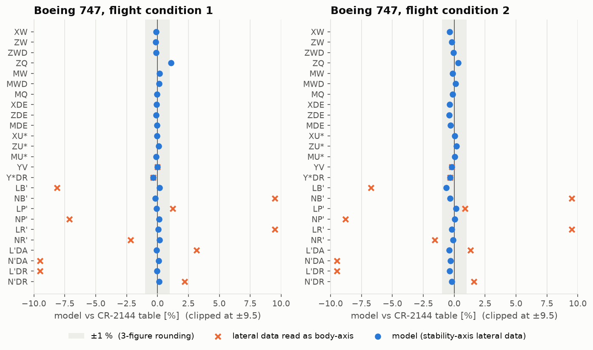

# Lesson 2 · Aerodynamic derivatives

> *The rigid body of Lesson 1 needs a force and a moment at every instant. For small motions
> about a steady flight condition, a first-order Taylor series is enough, and its
> coefficients — the stability derivatives — are how aircraft data is published. This lesson
> builds that model and uses it to audit two classic data sets.*

**Code:** [`src/flightdyn/aero_derivatives/`](../../src/flightdyn/aero_derivatives) ·
**Notebook:** [`02_aero_derivatives.ipynb`](../../notebooks/02_aero_derivatives.ipynb) ·
**Previous:** [Lesson 1 — Equations of motion](01-equations-of-motion.md) ·
**Next:** [Lesson 3 — Trim](03-trim.md)

## Learning objectives

By the end of this lesson you should be able to

1. write the linear derivative model of the six aerodynamic coefficients and explain each
   normalisation;
2. give the physical origin and sign of the main derivatives ($C_{m_{\alpha}}$, $C_{m_{q}}$,
   $C_{l_{\beta}}$, $C_{n_{\beta}}$, $C_{l_{p}}$, $C_{n_{r}}$ and the control derivatives);
3. transform derivatives between stability and body axes;
4. convert nondimensional derivatives to dimensional ones, including primed lateral
   derivatives;
5. check a published data set against itself.

---

## 1. The idea: Bryan's quasi-steady expansion

In 1911 G. H. Bryan proposed treating the aerodynamic force as a function of the
*instantaneous* motion variables, expanded about a reference flight condition. Each
coefficient becomes a sum of linear terms:

```math
\begin{aligned}
C_L &= C_{L_0} + C_{L_\alpha}\Delta\alpha + C_{L_{\dot\alpha}}\hat{\dot\alpha} + C_{L_q}\hat q + C_{L_M}\Delta M + C_{L_{\delta_e}}\delta_e \\
C_D &= C_{D_0} + C_{D_\alpha}\Delta\alpha + C_{D_M}\Delta M + C_{D_{\delta_e}}\delta_e \\
C_m &= C_{m_0} + C_{m_\alpha}\Delta\alpha + C_{m_{\dot\alpha}}\hat{\dot\alpha} + C_{m_q}\hat q + C_{m_M}\Delta M + C_{m_{\delta_e}}\delta_e \\
C_Y &= C_{Y_\beta}\beta + C_{Y_p}\hat p + C_{Y_r}\hat r + C_{Y_{\delta_a}}\delta_a + C_{Y_{\delta_r}}\delta_r
\end{aligned}
```

and likewise for the rolling and yawing moment coefficients $C_l$ and $C_n$. Rates are made
nondimensional with the time a fluid particle takes to cross half a reference length:

```math
\hat q = \frac{q\bar c}{2V}, \qquad \hat{\dot\alpha} = \frac{\dot\alpha\bar c}{2V}, \qquad \hat p = \frac{pb}{2V}, \qquad \hat r = \frac{rb}{2V}
```

Forces and moments are then $q_\infty S C$, with the chord $\bar c$ for pitch and the span $b$
for roll and yaw. Symmetry splits the derivatives cleanly. Longitudinal coefficients do not
depend on β, p or r to first order, and lateral ones do not depend on α, q or u. This is
why the linear modes of Lesson 4 split into two independent sets.

"Quasi-steady" means the air responds instantly. The one concession to memory is
$C_{m_{\dot\alpha}}$: the downwash from the wing takes $l_{t}/V$ to reach the tail, so the
tail sees the angle of attack of a moment ago.

## 2. What each derivative means

| Derivative | 747, fc 2 | Origin | Sign and role |
|---|---|---|---|
| $C_{L_{\alpha}}$ | 5.70 | wing lift slope, plus tail | > 0 |
| $C_{m_{\alpha}}$ | −1.26 | CG ahead of the neutral point | < 0: **static pitch stability** |
| $C_{m_{q}}$ | −20.8 | tail angle-of-attack change from pitch rate | < 0: pitch damping |
| $C_{m_{\dot\alpha}}$ | −3.2 | downwash lag at the tail | < 0: extra damping |
| $C_{m_{\delta_e}}$ | −1.34 | elevator lift times tail arm | < 0 with trailing edge down positive |
| $C_{n_{\beta}}$ | 0.150 | fin as a weathervane | > 0: **directional stability** |
| $C_{l_{\beta}}$ | −0.221 | dihedral and sweep | < 0: "dihedral effect", rolls away from sideslip |
| $C_{l_{p}}$ | −0.45 | down-going wing sees more angle of attack | < 0: roll damping |
| $C_{n_{r}}$ | −0.30 | fin side force from yaw rate | < 0: yaw damping |
| $C_{l_{r}}$ | 0.101 | outer wing moves faster in a yaw | > 0 |
| $C_{n_{p}}$ | −0.121 | lift vectors tilt with roll rate | usually < 0: adverse yaw |
| $C_{l_{\delta_a}}$ | 0.0461 | differential aileron lift | > 0 here: right wing down |
| $C_{n_{\delta_r}}$ | −0.109 | rudder side force times fin arm | < 0: nose left |

The values are the Boeing 747 in the power-approach condition (NASA CR-2144, Table IX-2).
Three rows carry most of the aircraft's character. $C_{m_{\alpha}} < 0$ makes the nose come back
after a gust. $C_{n_{\beta}} > 0$ points the nose into the wind. $C_{l_{\beta}} < 0$ lifts the
wing that sideslip pushes forward. The damping derivatives $C_{m_{q}}$, $C_{l_{p}}$, $C_{n_{r}}$ set
how fast the resulting oscillations die out.

## 3. Lift and drag in body axes

Lift and drag are defined relative to the airflow: perpendicular and parallel to the free
stream in the plane of symmetry. The equations of motion want body-axis forces, so the model
rotates them through the *instantaneous* angle of attack:

```math
X = q_\infty S\left(C_L\sin\alpha - C_D\cos\alpha\right), \qquad Z = -q_\infty S\left(C_L\cos\alpha + C_D\sin\alpha\right)
```

At high angle of attack this matters. In the 747's landing condition (α = 8.5°, $C_L$ = 1.76,
$C_D$ = 0.263) the forward tilt of lift, $C_L\sin\alpha$ = 0.260, cancels the axial part of
drag, $C_D\cos\alpha$ = 0.260: the body-axis axial force coefficient is almost exactly zero. Differentiating these expressions
gives the body-axis derivatives that CR-2144 tabulates in its Appendix B, for example

```math
C_{N_\alpha} = C_{L_\alpha}\cos\alpha_0 - C_L\sin\alpha_0 + C_{D_\alpha}\sin\alpha_0 + C_D\cos\alpha_0
```

The tests check every Appendix B formula against finite differences of the rotated model.

## 4. Stability axes and body axes

Rolling and yawing derivatives depend on which x axis you roll about. **Stability axes** are
body axes rotated by the reference angle of attack $\alpha_0$, so that x points into the
reference wind. They are still fixed to the aircraft: when it pitches, they pitch too. Data
sets come in either system, and mixing them is a classic error. Moments and rates rotate
with $\alpha_0$:

```math
\begin{pmatrix}L\\N\end{pmatrix}_{body} = \begin{pmatrix}\cos\alpha_0 & -\sin\alpha_0\\ \sin\alpha_0 & \cos\alpha_0\end{pmatrix}\begin{pmatrix}L\\N\end{pmatrix}_{stab},
\qquad
\begin{pmatrix}p\\r\end{pmatrix}_{stab} = \begin{pmatrix}\cos\alpha_0 & \sin\alpha_0\\ -\sin\alpha_0 & \cos\alpha_0\end{pmatrix}\begin{pmatrix}p\\r\end{pmatrix}_{body}
```

Rate derivatives pick up both rotations, so they mix as $\cos^2$, $\sin^2$ and $\sin\cos$ terms.
At α0 = 8.5° the 747's yaw stiffness changes from $C_{n_{\beta}}$ = 0.184 (stability) to 0.140
(body), a 24 % difference, and $C_{n_{\delta_a}}$ doubles from 0.0083 to 0.0160.

## 5. Dimensional derivatives

The linear equations of Lesson 4 are simplest per unit mass and inertia, in body axes. CR-2144
(Appendix A) defines, for example,

```math
Z_w = \frac{\rho S U_0}{2m}\left[-C_{N_\alpha} - 2\frac{W_0}{U_0}\left(C_N + \frac{M}{2}C_{N_M}\right)\right],
\qquad
M_q = \frac{\rho S\bar c^{2} V}{4I_{yy}}C_{m_q},
\qquad
L_\beta = \frac{\rho S V^2 b}{2I_{xx}}C_{l_\beta}
```

with $U_0 = V\cos\alpha_0$ and $W_0 = V\sin\alpha_0$. In stability axes ($W_0$ = 0) and at low Mach
the first one is the familiar $Z_w = -\rho SV(C_{L_\alpha} + C_D)/(2m)$. Every formula is the
derivative of the force model with respect to one state, so the tests verify all of them
against finite differences of the model itself.

The roll and yaw equations are coupled through $I_{xz}$ (Lesson 1). Solving them for
$\dot p$ and $\dot r$ folds that coupling into **primed derivatives**:

```math
L' = \frac{L + (I_{xz}/I_{xx})N}{1 - I_{xz}^2/(I_{xx}I_{zz})}, \qquad N' = \frac{N + (I_{xz}/I_{zz})L}{1 - I_{xz}^2/(I_{xx}I_{zz})}
```

so that $\dot p = L'_{\beta}\beta + L'_{p}p + \ldots$ and $\dot r = N'_{\beta}\beta + \ldots$ with no
inertia matrix left to invert.

```python
import sys

sys.path.insert(0, "validation")  # the reference aircraft
from reference_aircraft import b747, b747_condition

from flightdyn.aero_derivatives import dimensional_derivatives
from flightdyn.atmosphere import isa

ac, cond = b747(2), b747_condition(2)  # power approach, sea level, 165 KTAS
rho = float(isa(cond["h"], geopotential=True).rho)
dd = dimensional_derivatives(ac.aero, ac.geometry, ac.mass, rho, cond["V"])
print(f"Zw = {dd.Zw:.3f} 1/s, Mq = {dd.Mq:.3f} 1/s, Mde = {dd.Mde:.3f} 1/s^2")
print(f"Lp' = {dd.Lp_p:.3f} 1/s, Nb' = {dd.Nb_p:.3f} 1/s^2")
# Zw = -0.612 1/s, Mq = -0.436 1/s, Mde = -0.572 1/s^2
# Lp' = -1.102 1/s, Nb' = 0.246 1/s^2
```

## 6. Auditing the reference data

Both reference reports print the same aircraft twice: as nondimensional derivatives and as
dimensional derivatives computed from them. Running the first through the formulas above and
comparing with the second is a strong check, on the transcription and on the reports.



**The 747.** Twenty-four of the twenty-five derivatives agree within 0.65 %, the rounding of
three printed figures. The comparison also settles a question the report leaves open. Tables
IX-1 and IX-2 do not say which axes their lateral derivatives use. Read as stability-axis
derivatives (blue dots) they reproduce the dimensional table. Read as body-axis derivatives
(orange crosses) they miss by up to 115 %. Two derivatives needed a closer look:

- $M_{u}^{\ast}$ and $M_{w}$ contain the pitching moment coefficient at the reference. With
  $C_{m_0}$ = 0 they come out 1.6–3 times and 1.7 % off. They are reproduced to 0.1–0.2 % if
  the aerodynamic $C_m$ at the reference balances the moment of the published thrust line,
  $C_{m_0} = -Tl_{th}/(qS\bar c)$ = −0.096 (fc 1) and −0.037 (fc 2). The data was trimmed
  *with* the thrust moment, and Lesson 3 follows the consequences.
- $Z_{q}$ is 1.1 % off at fc 1. The table values equal the formula with $U_0$ where the force
  model gives $V$: a factor $\cos\alpha_0$.

**The Navion.** Every dimensional derivative in Teper's Table X-D is larger than Table X-B
implies, by exactly 2.22 % for moments and 2.31 % for forces. A uniform ratio points at one
shared input, and 1.0222 = 184/180: the dimensional table was computed with a wing area of
184 ft², while the geometry table prints 180 ft². The extra 0.08 % on forces is the printed
mass, 85.4 slug against W/g = 85.47 slug.

Neither finding is visible from either table alone. Both come from the habit this project
applies everywhere: compute every published number you can from other published numbers.

## 7. Common pitfalls

- **Mixing axis systems.** Stability-axis and body-axis lateral derivatives differ by tens of
  percent at landing angles of attack. Data tables do not always say which is which.
- **Forgetting the normalisation.** $C_{m_{q}}$ is per unit $q\bar c/(2V)$, not per rad/s. Some
  texts use $q\bar c/V$, which halves it.
- **Sign conventions for controls.** Check the sign of $C_{m_{\delta_e}}$, $C_{l_{\delta_a}}$
  and $C_{n_{\delta_r}}$ in each source before using its control inputs.
- **Using unprimed derivatives with $\dot p = L$.** Unless $I_{xz} = 0$, the roll equation needs
  either the inertia coupling or the primed derivatives.

## 8. Exercises

1. Show that in stability axes at low Mach, $Z_w = -\rho SV(C_{L_\alpha} + C_D)/(2m)$, and evaluate
   it for the Navion (S = 180 ft², V = 176 ft/s, W = 2750 lb, $C_{L_{\alpha}}$ = 4.44, $C_D$ = 0.05).
2. Transform the 747's fc 1 stability-axis $C_{l_{\beta}}$ = −0.281 and $C_{n_{\beta}}$ = 0.184 to body
   axes (α0 = 8.5°).
3. Why does $C_{m_{q}}$ come almost entirely from the horizontal tail? Estimate it as
   $-2\eta a_t V_H l_t/\bar c$ for $a_t$ = 4.5, $V_H$ = 0.8, $l_t/\bar c$ = 3, η = 1.
4. Explain why the dimensional derivatives contain $\rho V$ (damping terms) or $\rho V^2$
   (stiffness terms), and what that implies for mode frequencies at altitude.
5. For the Navion, $I_{xz}$ = 0. What are its primed derivatives?

<details>
<summary>Answers</summary>

1. With α0 = 0: $C_N = C_L$, $C_{N_{\alpha}} = C_{L_{\alpha}} + C_D$ and $W_0$ = 0. m = 2750/32.174 =
   85.47 slug, ρ = 0.002378: $Z_w$ = −0.002378 × 180 × 176 × 4.49 / (2 × 85.47) = −1.98 1/s.
   Teper prints −2.024, 2.3 % more (Section 6).
2. $C_{l_{\beta}}$ = −0.281 cos 8.5° − 0.184 sin 8.5° = −0.305; $C_{n_{\beta}}$ = 0.184 cos 8.5° +
   (−0.281) sin 8.5° = 0.140.
3. A pitch rate q changes the tail angle of attack by $ql_t/V$. The tail lift change times
   its arm gives $\Delta C_m = -\eta a_t V_H (2l_t/\bar c)\hat q$, so $C_{m_{q}}$ = −2 × 4.5 × 0.8 × 3
   = −21.6, close to the 747's −20.8. The wing's contribution is small because its arm is
   small.
4. Damping derivatives are force per unit rate: $q_\infty S\bar c \times \bar c/(2V) \propto \rho V$.
   Stiffness derivatives are force per unit angle: $\propto \rho V^2$. At constant true airspeed,
   higher altitude means lower ρ, so frequencies (√stiffness) and damping both fall. Lesson 4
   shows the short-period damping ratio dropping with altitude for this reason.
5. G = 1, so $L' = L$ and $N' = N$.

</details>

## Key takeaways

- The derivative model is a first-order Taylor series of the coefficients about a reference
  condition. Symmetry decouples longitudinal from lateral terms.
- $C_{m_{\alpha}}$, $C_{n_{\beta}}$ and $C_{l_{\beta}}$ give static stability. $C_{m_{q}}$, $C_{l_{p}}$ and
  $C_{n_{r}}$ give damping.
- Stability and body axes differ by a rotation through α0. Lateral derivatives mix strongly
  under it.
- Published data can be checked against itself. Here that settled an axis system, revealed
  that the 747's data is trimmed with the thrust moment, and found a wing-area mismatch in a
  fifty-year-old report.

## Further reading

- R. K. Heffley & W. F. Jewell, *Aircraft Handling Qualities Data*, NASA CR-2144 (1972),
  Appendices A and B.
- G. L. Teper, *Aircraft Stability and Control Data*, STI TR-176-1 (1969).
- B. Etkin & L. D. Reid, *Dynamics of Flight*, 3rd ed., Ch. 5.
- R. C. Nelson, *Flight Stability and Automatic Control*, 2nd ed., Ch. 2–4.
