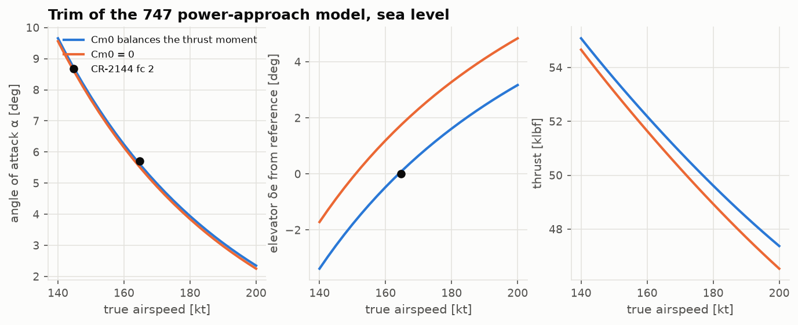
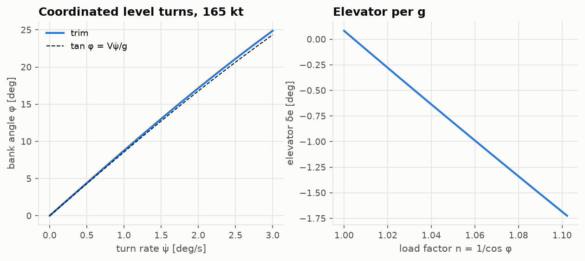

# Lesson 3 · Trim

> *An aircraft in steady flight is in equilibrium: every force and moment balances, and
> every body acceleration is zero. Finding the attitude and control settings that achieve
> this — trimming the aircraft — is the starting point for everything that follows. Stability
> is always stability* of *a trim point.*

**Code:** [`src/flightdyn/trim_solver/`](../../src/flightdyn/trim_solver) ·
**Notebook:** [`03_trim.ipynb`](../../notebooks/03_trim.ipynb) ·
**Previous:** [Lesson 2 — Aerodynamic derivatives](02-aerodynamic-derivatives.md) ·
**Next:** [Lesson 4 — Linearization and the classical modes](04-linearization-and-modes.md)

## Learning objectives

By the end of this lesson you should be able to

1. state what "steady flight" means for the twelve-state model, and which states may still
   change;
2. set up trim as a square system of nonlinear equations, for level flight, climbs and
   coordinated turns;
3. derive the pitch attitude for a given flight-path angle and the body rates of a steady
   turn;
4. solve the longitudinal trim of a linear model by hand, and use that to verify the solver;
5. read trim curves: angle of attack, elevator and thrust against speed, and elevator per g.

---

## 1. What steady means

Steady flight is a condition in which the velocity and angular velocity, seen from the
aircraft, do not change: $\dot u = \dot v = \dot w = \dot p = \dot q = \dot r = 0$. Bank and pitch
must stay constant too. Heading and position may change: in a steady turn ψ grows linearly,
and in a climb the altitude does. Strictly, a climb is steady only for an instant, because the
air gets thinner as the aircraft climbs. Over a few seconds that is negligible.

Three cases cover most of flight:

| Case | Specified | Free |
|---|---|---|
| straight and level | V, h | α, δe, T |
| climb or descent | V, h, γ | α, δe, T |
| coordinated turn | V, h, turn rate ψ̇ | α, φ, δe, δa, δr, T |

## 2. Trim as a root-finding problem

The solver in [`trim.py`](../../src/flightdyn/trim_solver/trim.py) uses one formulation for all
three. The unknowns are

```math
\mathbf z = \left(\alpha,\ \beta,\ \phi,\ \delta_e,\ \delta_a,\ \delta_r,\ T/W\right)
```

and the equations are the six body accelerations of the full nonlinear model of Lessons 1–2,
plus one constraint: zero sideslip (coordinated flight), or zero bank (wings level). Seven
equations, seven unknowns. Thrust is scaled by weight so that every unknown is of order one,
which keeps the Newton iterations of `scipy.optimize.root` well conditioned.

Two pieces of kinematics turn $(\alpha, \beta, \phi)$ into a full state. The pitch attitude
must make the velocity vector climb at exactly γ. With
$a = \cos\alpha\cos\beta$ and $b = \sin\phi\sin\beta + \cos\phi\sin\alpha\cos\beta$
(Stevens, Lewis & Johnson, ch. 3):

```math
\tan\theta = \frac{ab + \sin\gamma\sqrt{a^2 - \sin^2\gamma + b^2}}{a^2 - \sin^2\gamma}
```

which reduces to $\theta = \alpha + \gamma$ in wings-level flight. A steady turn is a constant
rotation ψ̇ about the vertical, which in body axes reads

```math
(p, q, r) = \dot\psi\left(-\sin\theta,\ \sin\phi\cos\theta,\ \cos\phi\cos\theta\right)
```

So even a "level" turn has a pitch rate and a yaw rate in body axes. Both create damping
moments that the elevator and rudder must hold.

```python
import sys

import numpy as np

sys.path.insert(0, "validation")
from reference_aircraft import b747, b747_condition

from flightdyn.trim_solver import trim
from flightdyn.units import LBF

ac, c = b747(2), b747_condition(2)  # power approach, 165 KTAS, sea level
t = trim(ac, c["V"], c["h"])
alpha, de = np.degrees(t.alpha), np.degrees(t.de)
print(f"alpha {alpha:.2f} deg, de {de:.2f} deg, T {t.thrust / LBF:.0f} lbf")
# alpha 5.62 deg, de 0.08 deg, T 51554 lbf
t = trim(ac, c["V"], c["h"], turn_rate=np.radians(3.0))
print(f"bank {np.degrees(t.phi):.1f} deg, n = {1 / np.cos(t.phi):.3f}")
# bank 24.9 deg, n = 1.102
```

## 3. Verifying the solver: a hand solution

For straight flight with thrust along the body x axis through the CG, the trim of a linear
derivative model reduces to one equation in α. Balance forces along and across the
velocity, and pitching moments:

```math
T\cos\alpha = D + W\sin\gamma, \qquad L + T\sin\alpha = W\cos\gamma, \qquad C_m(\alpha, \delta_e) = 0
```

The moment equation gives $\delta_e(\alpha) = -(C_{m_0} + C_{m_\alpha}\Delta\alpha)/C_{m_{\delta_e}}$. The
first gives T(α). Substituting both in the second leaves a scalar equation, solved by
bisection. That route never touches the body-axis equations, the α̇ resolution or the
direction cosines. The tests require the 6-DOF trim to match it to $10^{-10}$ rad in level
flight, a 3° climb and a 4° descent.

The turn gets a different independent check. In a level turn the centre of gravity
accelerates at $\dot\psi\hat z \times \mathbf v_{NED}$, so in inertial terms the
non-gravitational force must equal $m(\dot\psi\hat z \times \mathbf v - \mathbf g)$, and its bank
angle μ satisfies $\tan\mu = V\dot\psi/g$. The trim solver works in body axes, with
$\boldsymbol\omega \times \mathbf v$ terms. The test compares the two to $10^{-12}$.

The last check is the definition itself: start the nonlinear model at a trim point with the
trim controls held fixed, integrate 20 s, and confirm that nothing moves except heading and
position.

## 4. Trim curves



Sweeping speed shows how a stable aircraft is flown:

- **Angle of attack** falls with speed, roughly as $1/V^2$, because lift must stay equal
  to weight.
- **Elevator** moves trailing-edge-down as speed increases: from −1.8° at 150 kt to +1.6° at
  180 kt. A pilot must *push* to fly faster and *pull* to fly slower. That gradient is speed
  stability, and its sign follows from $C_{m_{\alpha}} < 0$: at higher speed α is lower, so
  $C_{m_{\alpha}}\Delta\alpha$ is a nose-up moment (both factors negative), which a
  trailing-edge-down elevator must cancel.
- **Thrust** falls slightly with speed here, because induced drag dominates near the approach
  speed. The linear drag model $C_D = C_{D_0} + C_{D_\alpha}\Delta\alpha$ captures that locally,
  but it is a tangent to the drag polar, not the polar.

The sweep is done by **continuation**: each trim starts from the previous solution. A
nonlinear solver started far from the answer may wander. Started next door, it converges
in a few iterations.



In a coordinated level turn, the bank angle follows $\tan\phi \approx V\dot\psi/g$. The
small difference from the dashed line is the angle between body x and the velocity. The
load factor is $n = 1/\cos\phi$: 1.10 at 25° of bank. The elevator needed per g is the
**manoeuvre stability** of the aircraft. It is larger than the speed-stability gradient
alone suggests, because the pitch rate of the turn adds a $C_{m_{q}}$ damping moment.

## 5. What "trimmed" data includes

Run the solver at the 747's published flight conditions and a modelling question appears.
The derivatives of CR-2144 are "for trimmed flight" at α0 = 8.5° (fc 1) and 5.7° (fc 2),
and the report also publishes the thrust line: 2.5° nose-up from the body axis, 10 ft below
the CG. At fc 1 the engines deliver about 83 000 lbf, a nose-up moment of 830 000 ft·lbf,
$\Delta C_m$ = +0.096. So what is the *aerodynamic* $C_m$ at the reference?

| fc 1 model | α trim (α0 = 8.5°) | δe trim | thrust |
|---|---|---|---|
| aerodynamic $C_{m_0}$ = 0 | 7.83° | +4.50° | 81 000 lbf |
| $C_{m_0}$ = −0.096, balancing the thrust moment | 8.06° | +0.42° | 82 600 lbf |
| thrust through the CG along x, $C_{m_0}$ = 0 | 8.17° | +0.34° | 82 800 lbf |

If "trimmed" meant $C_m$ = 0 for the airframe alone, the model would need 4.5° of elevator,
3.8° of it ($0.093/1.40$ rad) to hold the thrust moment and the rest for the lower α. The report itself settles the question, through its dimensional
derivatives. $M_u$ and $M_w$ (Lesson 2) both contain the reference $C_m$, and they are
reproduced to 0.1–0.2 % only with $C_{m_0} = -Tl_{th}/(q S\bar c)$. With $C_{m_0}$ = 0, $M_u$ comes
out 1.6–3 times too large. So the data was trimmed *with* the thrust moment: the tail carries
a download that balances the engines. The model therefore sets $C_{m_0}$ that way. The thrust
for it comes from the axial force balance at the reference (`b747_reference_cm0`), a
deduction labelled as such, not data.

One offset remains: α trims 0.44° below α0 at fc 1. The tabulated $C_L$ = 1.76 equals
W/(qS), so it does not count the lift of the thrust. Inclined at α + 2.5° to the flight path,
the thrust carries 2.6 % of the weight, and the wing needs correspondingly less angle of
attack. The tests check that the α offset equals this thrust lift over $qSC_{L_\alpha}$.

Two lessons generalise. Thrust effects on trim are not small for aircraft with low-slung
engines, and "trimmed" data needs to say what it includes. When a report does not say,
its other tables may: here the derivatives of one table decided a question that the
definitions in another left open.

## 6. Common pitfalls

- **Linearizing about a point that is not a trim.** The linear model of Lesson 4 assumes
  $\dot{\mathbf x} = 0$ at the reference. Off-trim, the constant term drives the "perturbation"
  model away from the start.
- **Over-constraining.** Specifying both β = 0 and φ = 0 in a turn has no solution. One of
  them must be free.
- **Unscaled unknowns.** Mixing radians with newtons of thrust in one Newton iteration
  makes the Jacobian badly conditioned. Scale thrust by weight.
- **Expecting the linear model to hold far from its reference.** The trim curves above
  extrapolate a tangent model ±20 kt from its reference. Beyond that, Mach and α
  nonlinearities would need tabulated data.

## 7. Exercises

1. Show that for wings-level flight the pitch-attitude formula reduces to θ = α + γ.
2. In a coordinated level turn at 165 kt (84.9 m/s) and 3°/s, find the bank angle from
   $\tan\phi = V\dot\psi/g$ and compare with the trim result above.
3. Derive the body rates of a steady level turn for θ = 0. Which rate grows with bank?
4. Using the 747 fc 1 numbers ($C_{m_{\delta_e}}$ = −1.40, q = 58.1 psf, S = 5500 ft²,
   c̄ = 27.31 ft), estimate the elevator needed to hold the moment of 81 000 lbf on a 10 ft
   arm if the airframe alone were trimmed.
5. Why does the elevator per g in a turn depend on $C_{m_{q}}$?

<details>
<summary>Answers</summary>

1. With β = φ = 0: a = cos α, b = sin α, and the formula becomes
   $\tan\theta = (\sin\alpha\cos\alpha + \sin\gamma\cos\gamma)/(\cos^2\alpha - \sin^2\gamma)$.
   Using product-to-sum identities, numerator = ½(sin 2α + sin 2γ) = sin(α+γ)cos(α−γ) and
   denominator = cos(α+γ)cos(α−γ). So tan θ = tan(α + γ).
2. tan φ = 84.9 × 0.0524 / 9.807 = 0.453, so φ = 24.4°. The trim gives 24.9°. The
   difference comes from α (6.7° in the turn) tilting body x away from the velocity.
3. With θ = 0: p = 0, q = ψ̇ sin φ, r = ψ̇ cos φ. The pitch rate grows with bank. In a
   steep turn the aircraft is mostly pitching, not yawing.
4. $\Delta C_m$ = 81 000 × 10 / (58.1 × 5500 × 27.31) = 0.0928. δe = 0.0928/1.40 = 0.066 rad =
   3.8°.
5. The turn has a body pitch rate $q = \dot\psi\sin\phi$, and $C_{m_{q}}\hat q$ is a nose-down
   moment opposing it. The elevator must supply that moment in addition to the one needed
   for the higher angle of attack.

</details>

## Key takeaways

- Trim = all six body accelerations zero. Heading and position may still change.
- One root-finding formulation handles level flight, climbs and coordinated turns: seven
  unknowns, six accelerations plus a sideslip or bank constraint.
- Verify trim against independent physics: a scalar wind-axis solution, the inertial
  centripetal balance, and a simulation that stays put.
- "Trimmed" data must say whether it includes the thrust moment. For the 747 the answer is
  worth 4.5° of elevator, and the report's own $M_u$ and $M_w$ reveal it.

## Further reading

- B. L. Stevens, F. L. Lewis & E. N. Johnson, *Aircraft Control and Simulation*, 3rd ed., Ch. 3
  (steady-state flight and the trim constraints).
- B. Etkin & L. D. Reid, *Dynamics of Flight*, 3rd ed., Ch. 2 (static stability and trim).
- R. C. Nelson, *Flight Stability and Automatic Control*, 2nd ed., Ch. 2.
