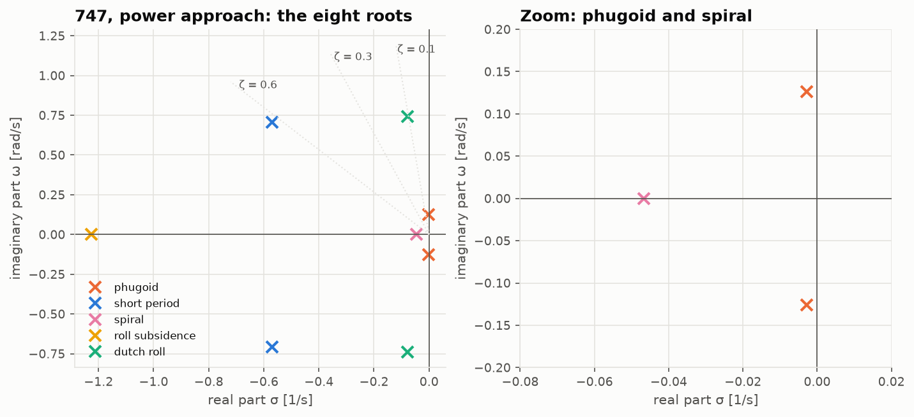
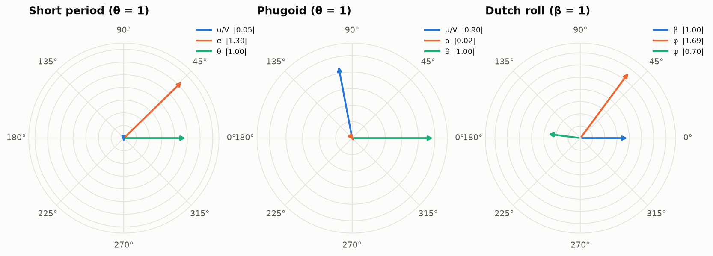
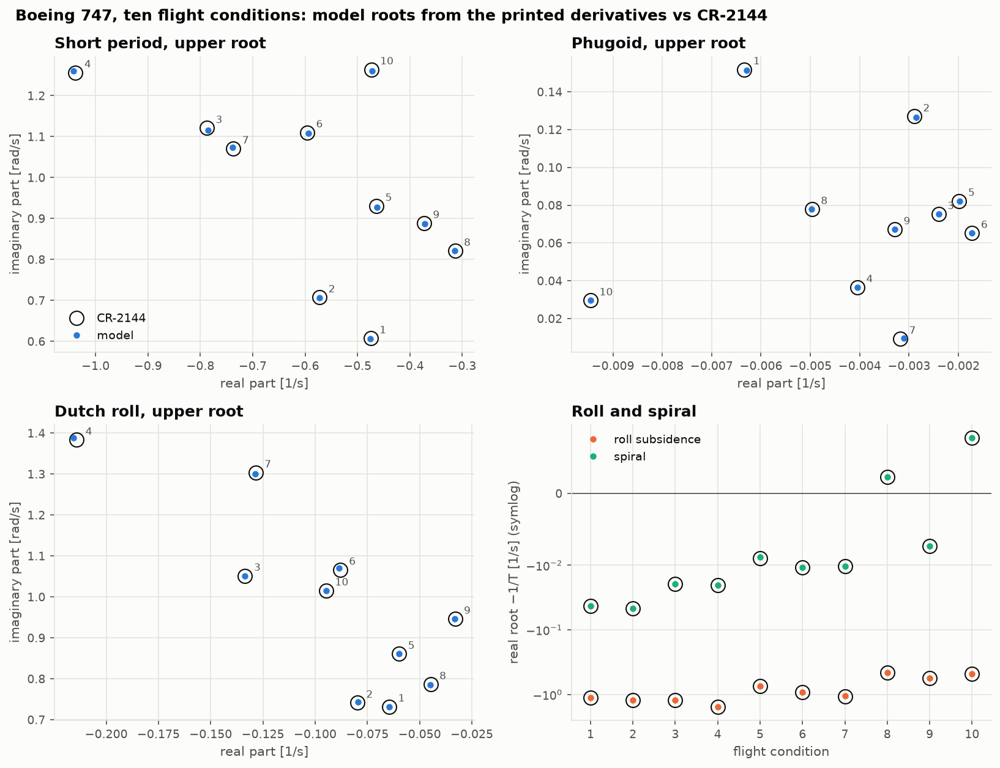

# Lesson 4 · Linearization and the classical modes

> *Disturb a trimmed aircraft slightly and it answers in five characteristic ways: two
> oscillations in pitch, an oscillation in yaw and roll, a quick roll subsidence and a slow
> spiral. They are the eigenvalues of the linearized equations, and every pilot knows them
> by feel. This lesson finds them, and checks them against two published data sets.*

**Code:** [`src/flightdyn/linearization/`](../../src/flightdyn/linearization),
[`src/flightdyn/modal_analysis/`](../../src/flightdyn/modal_analysis) ·
**Notebook:** [`04_linearization_and_modes.ipynb`](../../notebooks/04_linearization_and_modes.ipynb) ·
**Previous:** [Lesson 3 — Trim](03-trim.md) ·
**Next:** [Lesson 5 — Nonlinear simulation](05-nonlinear-simulation.md)

## Learning objectives

By the end of this lesson you should be able to

1. linearize the nonlinear model about a trim point, numerically and analytically, and
   explain why the two must agree;
2. explain why symmetric flight splits into independent longitudinal and lateral sets;
3. read natural frequency, damping ratio, period and time to half from an eigenvalue;
4. describe the physics of the phugoid, short period, dutch roll, roll subsidence and spiral,
   and their mode shapes;
5. say when the classical low-order approximations can be trusted.

---

## 1. Linearization

Near a trim point $(\mathbf x_0, \mathbf u_0)$ with $\mathbf f(\mathbf x_0, \mathbf u_0) = 0$, a
first-order Taylor series of $\dot{\mathbf x} = \mathbf f(\mathbf x, \mathbf u)$ gives the linear model

```math
\Delta\dot{\mathbf x} = \mathbf A\,\Delta\mathbf x + \mathbf B\,\Delta\mathbf u, \qquad
\mathbf A = \left.\frac{\partial\mathbf f}{\partial\mathbf x}\right|_0, \qquad
\mathbf B = \left.\frac{\partial\mathbf f}{\partial\mathbf u}\right|_0
```

There are two ways to get the Jacobians, and the code does both.

**Numerically.** [`linearize`](../../src/flightdyn/linearization/numerical.py) perturbs each
state and control of the full nonlinear model by a small step, up and down, and takes central
differences. Steps are scaled to each variable (a fraction of airspeed for velocities, 1e-5 rad
for angles, a fraction of weight for thrust). The truncation error is $O(h^2)$.

**Analytically.** [`longitudinal_model`](../../src/flightdyn/linearization/small_perturbation.py)
and `lateral_model` write the classical small-perturbation equations (CR-2144 Appendix C,
Etkin & Reid ch. 6) from the dimensional derivatives of Lesson 2:

```math
\begin{pmatrix}1 - X_{\dot u} & -X_{\dot w} & 0 & 0\\ -Z_{\dot u} & 1 - Z_{\dot w} & 0 & 0\\ -M_{\dot u} & -M_{\dot w} & 1 & 0\\ 0 & 0 & 0 & 1\end{pmatrix}
\begin{pmatrix}\dot u\\ \dot w\\ \dot q\\ \dot\theta\end{pmatrix}
=
\begin{pmatrix}X_u & X_w & X_q - W_0 & -g\cos\theta_0\\ Z_u & Z_w & Z_q + U_0 & -g\sin\theta_0\\ M_u & M_w & M_q & 0\\ 0 & 0 & 1 & 0\end{pmatrix}
\begin{pmatrix}u\\ w\\ q\\ \theta\end{pmatrix} + \mathbf G\,\Delta\mathbf u
```

```math
\begin{pmatrix}\dot\beta\\ \dot p\\ \dot r\\ \dot\phi\end{pmatrix}
=
\begin{pmatrix}Y_v & (Y_p + W_0)/V & (Y_r - U_0)/V & g\cos\theta_0/V\\ L'_\beta & L'_p & L'_r & 0\\ N'_\beta & N'_p & N'_r & 0\\ 0 & 1 & \tan\theta_0 & 0\end{pmatrix}
\begin{pmatrix}\beta\\ p\\ r\\ \phi\end{pmatrix} + \ldots
```

The matrix on the left of the longitudinal set comes from the $\dot\alpha$ derivatives. Since
$\dot\alpha = (U_0\dot w - W_0\dot u)/V^2$ in body axes, an $\dot\alpha$ effect produces both a $\dot w$
and a $\dot u$ term. Section 6 shows why that detail matters.

The tests require the two routes to agree to $10^{-8}$ for the 747 in both conditions and for
the Navion. They share no code beyond the force model, so agreement checks the transport
terms, gravity, the $\dot\alpha$ resolution, the derivative formulas and the axis
transformations all at once.

## 2. Two independent problems

For symmetric flight — wings level, no sideslip — the twelve-state Jacobian has a block
structure. Longitudinal states (u, w, q, θ) do not feed lateral ones (v, p, r, φ), and vice
versa. The coupling entries are zero to $10^{-31}$ in the tests. Heading and position are
pure integrators: they do not feed back on a flat Earth, and altitude feeds back only weakly,
through density. So the eight dynamic states split into two 4×4 problems, each with four
eigenvalues.

## 3. Reading an eigenvalue

A complex pair $\lambda = -\zeta\omega_n \pm i\omega_n\sqrt{1 - \zeta^2}$ is an oscillation:

| Quantity | Formula | Meaning |
|---|---|---|
| natural frequency | $\omega_n = \lvert\lambda\rvert$ | how stiff |
| damping ratio | $\zeta = -\mathrm{Re}(\lambda)/\lvert\lambda\rvert$ | how quickly it dies, per cycle |
| period | $2\pi/\mathrm{Im}(\lambda)$ | seconds per cycle |
| time to half | $\ln 2/(-\mathrm{Re}(\lambda))$ | negative: time to double |

A real root $\lambda = -1/T$ is a subsidence with time constant T, or a divergence if
$\lambda > 0$.

```python
import sys

sys.path.insert(0, "validation")
from reference_aircraft import b747, b747_condition

from flightdyn.linearization import lateral, linearize, longitudinal
from flightdyn.modal_analysis import lateral_modes, longitudinal_modes
from flightdyn.trim_solver import trim

ac, c = b747(2), b747_condition(2)
t = trim(ac, c["V"], c["h"])
lm = linearize(ac, t)
modes = longitudinal_modes(longitudinal(lm).A) | lateral_modes(lateral(lm, c["V"]).A)
for name, m in modes.items():
    if m.is_oscillatory:
        print(f"{name:13s} wn {m.wn:.3f} rad/s  zeta {m.zeta:.3f}  period {m.period:.1f} s")
    else:
        print(f"{name:13s} T {m.time_constant:.2f} s")
# phugoid       wn 0.126 rad/s  zeta 0.022  period 49.8 s
# short_period  wn 0.908 rad/s  zeta 0.629  period 8.9 s
# spiral        T 21.43 s
# roll          T 0.82 s
# dutch_roll    wn 0.745 rad/s  zeta 0.106  period 8.5 s
```



The roots spread over two decades. The short period and the roll subsidence die in a couple
of seconds. The dutch roll takes about 9 s to halve. The phugoid and spiral are so slow that
a pilot corrects them without thinking: the phugoid takes 250 s to halve here.

## 4. The longitudinal modes



**Short period.** A fast pitching oscillation at almost constant speed: u/V is 5 % of θ in
the left phasor diagram. Angle of attack and pitch attitude swing together, α leading θ by
about 45°. The restoring spring is $C_{m_{\alpha}}$ (the static margin) and the damper is $C_{m_q}$
plus $C_{m_{\dot\alpha}}$. With speed frozen, the two-state (w, q) model gives

```math
s^2 - \left(Z_w + M_q + M_{\dot w}U_0\right)s + Z_wM_q - U_0M_w = 0,
\qquad \omega_{sp}^2 \approx -U_0M_w = -M_\alpha
```

so the short-period frequency is the square root of the pitch stiffness. For the 747 at
fc 2 it gives ωn within 2.4 % and ζ within 1 % of the exact roots.

**Phugoid.** A slow exchange of kinetic and potential energy at almost constant angle of
attack (α is 2 % of θ in the middle diagram). The aircraft climbs, slows, noses over, dives,
speeds up and climbs again, with speed leading pitch by about 90°. Lanchester (1908) showed
that if lift balances weight at every instant and drag is ignored,

```math
\omega_{ph} \approx \sqrt2\,\frac{g}{V}, \qquad \zeta_{ph} \approx \frac{1}{\sqrt2}\frac{C_D}{C_L}
```

The frequency estimate is 29 % high for the 747 at fc 2 and the damping estimate is off by a
factor of three. Lanchester's assumptions fail in two ways: the speed derivative $M_u$ is
not zero (the thrust-moment trim of Lesson 3 makes it positive, which destabilises the
phugoid), and α is not quite constant. The phugoid is the mode most sensitive to small
terms. Section 6 shows how sensitive.

## 5. The lateral modes

**Roll subsidence.** A pure first-order roll response: roll rate decays as $e^{L'_p t}$ with
time constant $T_r \approx -1/L'_p$. Wing roll damping is large, so this takes under a second
(0.82 s for the 747 at fc 2). It sets how crisply the aircraft answers the ailerons.

**Spiral.** A very slow, often slightly divergent mode. In a small bank the aircraft
sideslips into the turn. Dihedral effect ($L'_\beta$) rolls it back level, while yaw stiffness
and the rolling moment from yaw rate ($N'_\beta$, $L'_r$) steepen the turn. The spiral is
stable when

```math
L'_\beta N'_r - N'_\beta L'_r > 0
```

that is, when dihedral effect and yaw damping beat directional stiffness. Lots of fin makes
the spiral unstable, and lots of dihedral makes it stable. The 747 is spirally stable at low
speed (T = 21 s at fc 2) and mildly divergent at 40 000 ft (fc 8 and 10, time to double
300 s and 90 s), which is acceptable: certification asks only that a divergence be slow.

**Dutch roll.** A coupled yaw-roll oscillation, named after the motion of a skater. The nose
weaves left and right while the wings rock. The phasor diagram shows the 747's roll
amplitude 1.7 times its sideslip. That large roll component is typical of swept-wing jets with
strong dihedral effect, and it is why the two-state (β, r) approximation, which suppresses roll,
gets the 747's dutch-roll damping wrong by a factor of 2.5 (validation report). For the Navion,
with half the ratio $L'_\beta/N'_\beta$, the same approximation is off by about 15 %.

## 6. Validation against the published roots

Both reports publish the denominators of their transfer functions: the characteristic roots.
The cleanest test feeds the reports' own printed dimensional derivatives through the linear
models and compares.

**The Navion** (Teper, Tables X-D and X-E → X-F and X-G) is reproduced to every printed
digit: the eight mode numbers agree within 0.11 %.

**The Boeing 747** (CR-2144, ten flight conditions from sea level to 40 000 ft) agrees within
1.2 % for every mode at every condition, with two exceptions that the rounding of the inputs
explains. The derivatives are printed to three figures. A Monte Carlo over their rounding
intervals shows how much the roots can move: for fc 7's nearly critically damped phugoid
the band runs from −11 % to +0.5 % in ζ, so its −6 % is no disagreement; fc 5's spiral
(−1.8 %) is likewise inside its band.



Getting there took one discovery. CR-2144's Appendix C states that the $\dot u$ terms of the
$\dot\alpha$ effect ($Z_{\dot u}$, $M_{\dot u}$) are neglected, and its tables print no $X_q$. Built that
way, the model misses the published phugoid damping by 7–9 % at fc 1 and 2, well outside the
rounding band. Adding the three terms the force model implies, each computed from printed
values ($Z_{\dot u} = -(W_0/U_0)Z_{\dot w}$, $M_{\dot u} = -(W_0/U_0)M_{\dot w}$,
$X_q = -\tan\alpha_0 Z_q/\cos\alpha_0$), brings every condition but fc 7 within 1.1 %. So the report's
numbers were computed with them, whatever its appendix says. That 7–9 % shift comes from
derivatives of order $10^{-5}$ to $10^{-3}$, a reminder of how sensitive the phugoid is.

Two more routes check the rest of the chain (validation report, section 2–3):

- **Reference route.** The 747's *nondimensional* derivatives, run through Appendix A and the
  analytic models at the published condition, reproduce every published root within 1.2 %.
- **Trim route.** The full nonlinear model, trimmed at the published speed and altitude and
  linearized numerically, matches the short period, roll and dutch-roll frequency within 0.5 %,
  but the phugoid damping is 10 % lower at fc 1. The model trims 0.44° below α0, because the
  tabulated $C_L$ leaves out the lift of the thrust (Lesson 3), and the phugoid feels that.

## 7. Common pitfalls

- **Linearizing off trim.** If $\mathbf f(\mathbf x_0, \mathbf u_0) \ne 0$, the linear model has a
  forcing term that the A matrix does not show.
- **Mixing axes between derivatives and inertias.** Stability-axis derivatives need
  stability-axis inertias. [`to_stability_axes`](../../src/flightdyn/aero_derivatives/model.py)
  rotates both, and the tests confirm the eigenvalues do not change.
- **Trusting approximations everywhere.** Short-period and roll approximations are good. The
  phugoid, spiral and dutch-roll damping approximations can be off by factors of 2–3 for a
  large swept-wing jet.
- **Over-reading phugoid damping.** It is a small difference of large numbers. Small
  modelling choices move it by several percent.

## 8. Exercises

1. A mode has λ = −0.5 ± 2.0i. Find ωn, ζ, the period and the time to half amplitude.
2. Using $\omega_{sp}^2 \approx -M_\alpha$ and $M_\alpha = U_0M_w$, estimate the 747's short-period
   frequency at fc 2 from $M_w$ = −0.00193 1/(ft·s) and U0 = 276.6 ft/s.
3. Lanchester's phugoid period is $\sqrt2\pi V/g$. Evaluate it for the 747 at 165 kt and
   compare with 49.8 s.
4. Use the spiral criterion to show that more dihedral effect stabilises the spiral and more
   directional stiffness destabilises it.
5. Why does the 747's dutch roll look so different from the Navion's in the phasor diagram?

<details>
<summary>Answers</summary>

1. ωn = √(0.25 + 4) = 2.06 rad/s; ζ = 0.5/2.06 = 0.243; period = 2π/2.0 = 3.14 s; time
   to half = ln 2/0.5 = 1.39 s.
2. $M_\alpha$ = 276.6 × 0.00193 = 0.534 1/s², so ωsp ≈ 0.73 rad/s. The exact 0.91 rad/s is
   higher, because $Z_wM_q$ = 0.613 × 0.437 = 0.27 adds to the stiffness term.
3. V = 278 ft/s: T = √2 π × 278/32.17 = 38.4 s. The model's 49.8 s is 30 % longer: the
   phugoid frequency is lowered by the positive $M_u$ and by compressibility and α
   variation that Lanchester ignores.
4. Stability needs $L'_\beta N'_r > N'_\beta L'_r$, with $L'_\beta$ < 0, $N'_r$ < 0, $N'_\beta$ > 0 and
   $L'_r$ > 0. A more negative $L'_\beta$ raises the left side; a larger $N'_\beta$ raises the
   right side. That is the designer's dilemma: the fin that gives a well-damped, stiff dutch
   roll pushes the spiral toward divergence, and dihedral that steadies the spiral makes the
   dutch roll roll more.
5. Relative to its directional stiffness, the 747 has a large dihedral effect (from wing
   sweep): $L'_\beta/N'_\beta$ = −1.63/0.247 = −6.6, against −3.6 for the Navion. Each degree
   of sideslip therefore rolls the 747 about twice as hard, and the dutch roll becomes a
   rolling motion.

</details>

## Key takeaways

- Linearize numerically and analytically, and require agreement. Each route checks the other.
- Symmetric flight splits into two 4×4 problems: phugoid and short period; roll, spiral and
  dutch roll.
- ωn, ζ, period and time to half are read directly from the eigenvalues. Mode shapes show
  which states move together.
- The model reproduces the Navion's published roots to every digit and the 747's within
  1.2 % at ten conditions, once the $\dot\alpha$ terms the report really used are included.

## Further reading

- B. Etkin & L. D. Reid, *Dynamics of Flight*, 3rd ed., Ch. 6 (longitudinal) and Ch. 8
  (lateral).
- R. C. Nelson, *Flight Stability and Automatic Control*, 2nd ed., Ch. 4–5.
- D. McRuer, I. Ashkenas & D. Graham, *Aircraft Dynamics and Automatic Control*, Ch. 6–7.
- R. K. Heffley & W. F. Jewell, *Aircraft Handling Qualities Data*, NASA CR-2144, Section IX
  and Appendix C.
