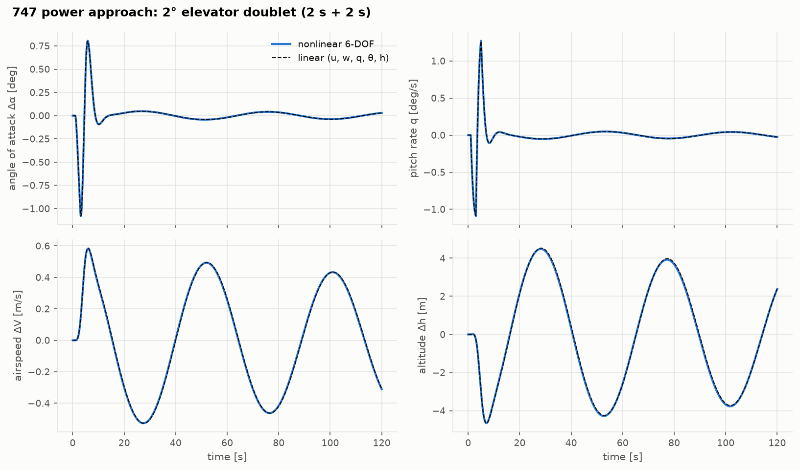
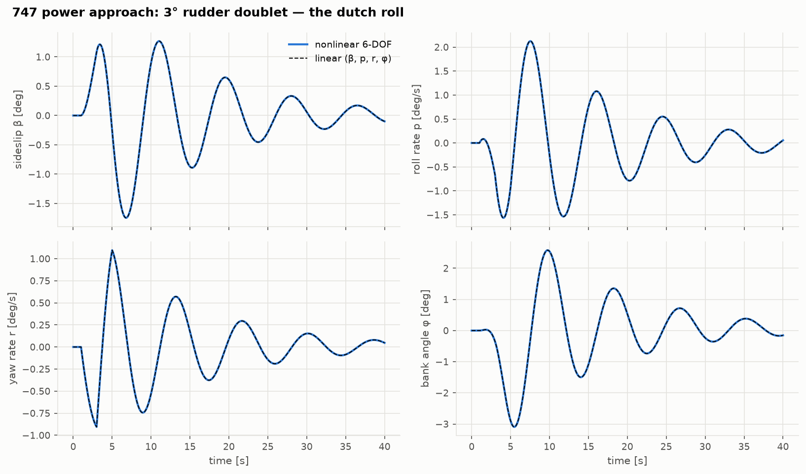
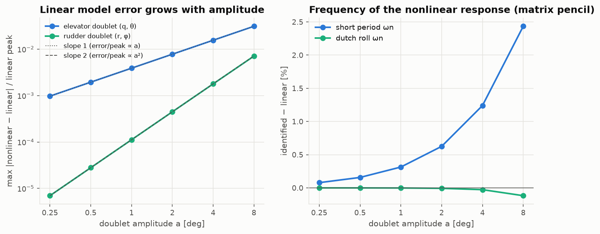
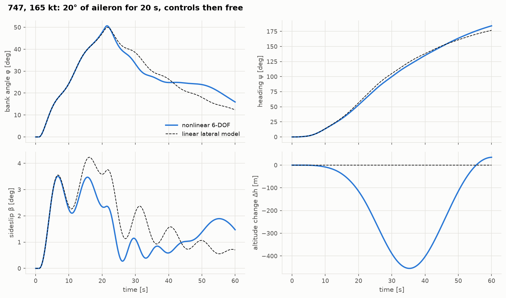

# Lesson 5 · Nonlinear simulation

> *Eigenvalues are predictions. To believe them, fly the full nonlinear aircraft, kick it
> with the controls, and see whether it really oscillates at those frequencies. Then kick it
> harder, and find out where the predictions stop being true.*

**Code:** [`src/flightdyn/nonlinear_sim/`](../../src/flightdyn/nonlinear_sim) ·
**Notebook:** [`05_nonlinear_simulation.ipynb`](../../notebooks/05_nonlinear_simulation.ipynb) ·
**Previous:** [Lesson 4 — Linearization and the classical modes](04-linearization-and-modes.md) ·
**Next:** [Lesson 6 — Stability trade studies](06-stability-trade-studies.md)

## Learning objectives

By the end of this lesson you should be able to

1. simulate the nonlinear model under step, pulse and doublet inputs, and integrate cleanly
   across control discontinuities;
2. explain why the doublet is the standard flight-test input;
3. extract frequencies and damping from a time history without a model, using the matrix
   pencil method;
4. predict how the error of the linear model grows with input size, and why lateral inputs
   behave differently from longitudinal ones;
5. recognise the couplings a decoupled linear model cannot represent.

---

## 1. Inputs and integration

Flight-test engineers excite modes with a few standard shapes, all available in
[`inputs.py`](../../src/flightdyn/nonlinear_sim/inputs.py):

| Input | Shape | Excites |
|---|---|---|
| step | jump and hold | the steady response and the slow modes |
| pulse | jump, hold for a while, release | a broad band, but leaves a net change |
| doublet | +a for T, −a for T | a band around ω ≈ 2.3/T, zero mean, returns to trim |

The **doublet** is the workhorse. Its zero mean means the aircraft ends near its trim
condition, and its spectrum peaks at $\omega \approx 2.33/T$ (exercise 1) and falls to zero at
very low frequency. A 2 s + 2 s doublet peaks at 1.2 rad/s, close to the 747's short period
(0.9 rad/s), dutch roll (0.75 rad/s) and roll subsidence (1.2 1/s), and puts little energy
into the 50 s phugoid.

Every input is piecewise constant, so the simulator
([`simulate.py`](../../src/flightdyn/nonlinear_sim/simulate.py)) integrates piecewise. It
stops at each control jump and restarts with the new control, using an 8th-order Runge–Kutta
method (DOP853) with tolerances of $10^{-10}$. Stepping blindly across a discontinuity
would make the integrator thrash or smear the jump. Output samples come from the method's
dense output, so they cost no extra steps.

`simulate_linear` runs any `LinearModel` through the same inputs, in perturbation variables.
The test suite checks it against the exact step response $x(t) = A^{-1}(e^{At} - I)Bu$ from the
matrix exponential.

## 2. A doublet, nonlinear and linear



A 2° elevator doublet on the trimmed 747 in the power approach. The first ten seconds are
the short period: a sharp swing in angle of attack and pitch rate that is gone within one
cycle (ζ = 0.63). What remains is the phugoid: a 50 s oscillation in speed and height,
±0.5 m/s and ±4 m, with angle of attack nearly constant. The dashed linear prediction lies
on top of the nonlinear response throughout.

There is one subtlety in plotting it. The linear states are body-axis velocity perturbations
Δu and Δw. Airspeed and angle of attack are projections of them,

```math
\Delta V = \frac{U_0\Delta u + W_0\Delta w}{V}, \qquad \Delta\alpha = \frac{U_0\Delta w - W_0\Delta u}{V^2}
```

and with α0 = 5.6° the difference between Δu and ΔV is visible. Comparing the wrong
quantities makes a correct model look wrong.



A 3° rudder doublet shows the dutch roll: sideslip, roll rate and yaw rate oscillating
together at 8.5 s per cycle. The bank angle swings ±3° while sideslip swings ±1.5°. That
roll-to-sideslip ratio of about 2 is the mode shape of Lesson 4.

## 3. Reading the modes from a time history

The doublet's aftermath is a free response: a sum of damped exponentials. The **matrix
pencil method** (Hua & Sarkar, 1990) recovers their exponents directly from equally spaced
samples, with no model. Arrange the samples in a Hankel matrix and shift it by one sample.
For data made of M exponentials $z_i^k$, the two shifted matrices are related through the
$z_i$, which appear as the eigenvalues of a small matrix pencil. A singular value
decomposition first filters the data to M components. Several output channels are stacked,
so every channel constrains the same poles.

```python
import sys

import numpy as np

sys.path.insert(0, "validation")
from reference_aircraft import b747, b747_condition

from flightdyn.nonlinear_sim import Doublet, damped_pairs, matrix_pencil, simulate
from flightdyn.trim_solver import trim

ac, c = b747(2), b747_condition(2)
t = trim(ac, c["V"], c["h"])
doublet = Doublet("dr", amplitude=np.radians(1.0), start=1.0, width=2.0)
r = simulate(ac, t.x, t.controls, [doublet], t_end=60.0, dt=0.05)

free = r.t >= 5.0  # after the input: a free response
lateral = r.x[free][:, [1, 3, 5, 6]] - t.x[[1, 3, 5, 6]]  # v, p, r, phi
(dutch_roll,), real = damped_pairs(matrix_pencil(lateral, 0.05, order=4))
print(f"dutch roll: wn {abs(dutch_roll):.3f} rad/s, zeta {-dutch_roll.real / abs(dutch_roll):.3f}")
print(f"roll and spiral roots: {real[1]:.3f}, {real[0]:.4f} 1/s")
# dutch roll: wn 0.745 rad/s, zeta 0.106
# roll and spiral roots: -1.222, -0.0467 1/s
```

Those are the linear eigenvalues of Lesson 4, recovered from a nonlinear flight. The
validation script does the same for every mode with 0.25° doublets
([results](../../validation/results/simulation_validation.md)):

| Mode | nonlinear flight (pencil) | linear model | difference |
|---|---|---|---|
| short period ωn | 0.9092 rad/s | 0.9085 rad/s | 0.08 % |
| phugoid ωn | 0.1283 rad/s | 0.1283 rad/s (with altitude) | < 0.01 % |
| dutch roll ωn | 0.7446 rad/s | 0.7446 rad/s | < 0.01 % |
| roll subsidence λ | −1.2251 1/s | −1.2253 1/s | 0.02 % |
| spiral λ | −0.04667 1/s | −0.04667 1/s | < 0.01 % |

The phugoid line carries a lesson. Against the 4-state longitudinal model (u, w, q, θ) the
nonlinear phugoid is 1.6 % faster and 6 % less damped. The aircraft climbs and dives a few
metres per cycle, and the air density changes with it, so lift and drag change with
altitude. A linear model with altitude as a fifth state matches the nonlinear flight to five
digits. This density-gradient effect grows with speed and is why the phugoid of fast aircraft
can couple into a separate "height mode".

## 4. How the linear model fails

The linear model is the first-order term of a Taylor series. The difference from the
nonlinear response should therefore start at second order in the input amplitude a:
relative to the response itself, error ∝ a.



The elevator doublet does exactly that: the relative error doubles each time the amplitude
doubles, from 0.1 % at 0.25° to 3 % at 8°. The rudder doublet does something different. Its
relative error grows as a², from $7\times10^{-6}$ to 0.7 %. The reason is symmetry. Mirror the
aircraft left-to-right and a right rudder input becomes a left one, while every lateral
state changes sign. So the lateral states are *odd* functions of a lateral input, and the
quadratic term of their Taylor series vanishes. The first error term is cubic. The tests
check both orders: the error ratio between amplitudes 1° and 0.5° is 4.0 for the elevator
and 8.0 for the rudder.

The right panel shows the same thing in the frequencies. The short period identified from
the nonlinear response drifts from its linear value in proportion to the amplitude (2.4 % at
8°). The dutch roll barely moves.

## 5. Coupling: what no decoupled model can see



Hold 20° of aileron for 20 s and the 747 rolls to 50° of bank. For the first 20 s the
lateral linear model follows the bank angle and heading well. It cannot follow the
altitude, because altitude is not a lateral state. In a 50° bank the wing's lift has a
vertical component of only $\cos 50°$ = 64 % of the weight, so the aircraft sinks 450 m and
picks up speed before the phugoid brings it back. Meanwhile the changing speed and dynamic
pressure alter every lateral derivative, and the sideslip and bank drift away from the
linear prediction.

This is the boundary of linear analysis. Symmetric decoupling holds for small motions about
symmetric flight. A steep turn is neither small nor symmetric. That is why trim (Lesson 3)
can be done about a turning flight condition, and why simulators run the nonlinear equations.

## 6. Common pitfalls

- **Integrating across a control jump.** An adaptive integrator will cope, slowly and with
  local error at the jump. Stopping at breakpoints is cheaper and exact.
- **Comparing the wrong variables.** Linear perturbations of body velocities are not
  perturbations of airspeed and angle of attack at nonzero α0.
- **Fitting modes to forced data.** Identification works on the free response, after the
  input has ended.
- **Forgetting altitude.** A 4-state phugoid is an approximation: the nonlinear aircraft
  flies through a density gradient.

## 7. Exercises

1. Show that a doublet of amplitude a and half-width T has zero mean, and find the frequency
   at which its Fourier transform peaks.
2. Explain from symmetry why an *elevator* input produces no sideslip at all in the nonlinear
   model, at any amplitude.
3. If the relative error of the linear model is 3 % for an 8° elevator doublet, estimate it
   for 1°. Compare with the table.
4. A free response contains the modes λ = −0.5 ± 0.7i and −0.003 ± 0.13i. What length of
   record and sampling interval would you choose to identify both?
5. In a coordinated 30° banked turn, what fraction of the aircraft's weight does the vertical
   component of lift carry if the pilot does not pull? What happens next?

<details>
<summary>Answers</summary>

1. The integral is aT − aT = 0. Its Fourier transform is $2ia\sin^2(\omega T/2)/(\omega/2)$
   times a phase, with magnitude $4a\sin^2(\omega T/2)/\omega$. Setting the derivative to zero
   gives $\tan(\omega T/2) = \omega T$, so $\omega T \approx 2.33$, about 1.2 rad/s for T = 2 s.
2. A symmetric aircraft disturbed symmetrically stays symmetric: the mirror image of the
   motion is itself, so v, p, r and φ must equal their own negatives. They stay zero.
3. Relative error ∝ a, so 3 % × 1/8 ≈ 0.39 %. The table gives 0.388 %.
4. The phugoid period is 2π/0.13 ≈ 48 s and it decays slowly, so several hundred seconds
   (the validation uses 300 s). The short period needs a few samples per cycle of 9 s and
   per time constant of 2 s, so 0.1 s is ample.
5. cos 30° = 87 %. The aircraft starts to sink and accelerate. Its angle of attack rises as
   the flight path bends down, and the phugoid sets in. A coordinated level turn needs a pull
   to load factor 1/cos 30° = 1.15 (Lesson 3).

</details>

## Key takeaways

- Simulate piecewise between input breakpoints. Doublets excite a mode and return to trim.
- The matrix pencil extracts modes from a time history without a model. Applied to the
  nonlinear 747, it recovers the linear eigenvalues to better than 0.1 %.
- The linear model's error grows as a² for longitudinal inputs and a³ for lateral ones,
  because symmetry removes the quadratic lateral term.
- Large manoeuvres couple the lateral and longitudinal motion, and only the nonlinear
  equations capture them.

## Further reading

- B. L. Stevens, F. L. Lewis & E. N. Johnson, *Aircraft Control and Simulation*, 3rd ed., Ch. 3
  (simulation) and Ch. 4 (linearization).
- R. V. Jategaonkar, *Flight Vehicle System Identification*, Ch. 2 (input design).
- Y. Hua & T. K. Sarkar, "Matrix pencil method for estimating parameters of exponentially
  damped/undamped sinusoids in noise", *IEEE Trans. ASSP* 38(5), 1990.
