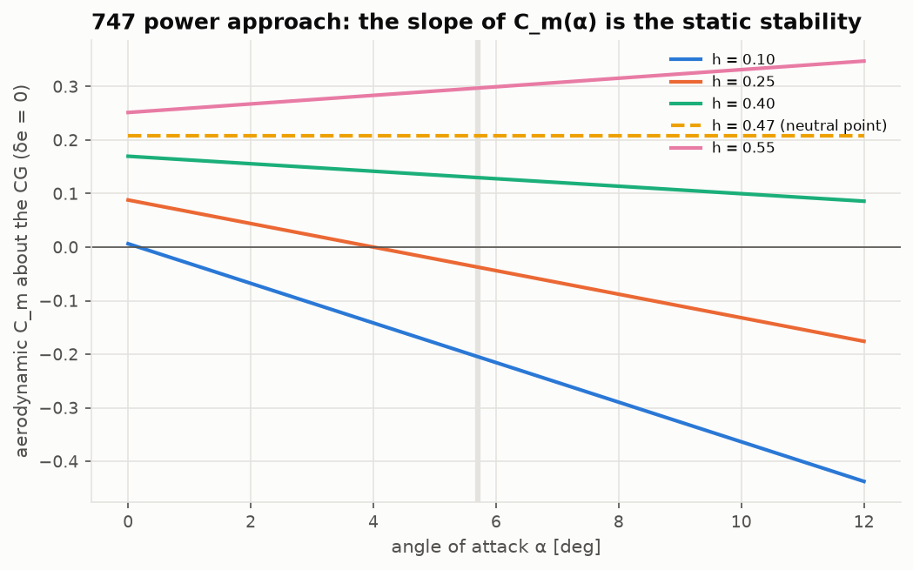
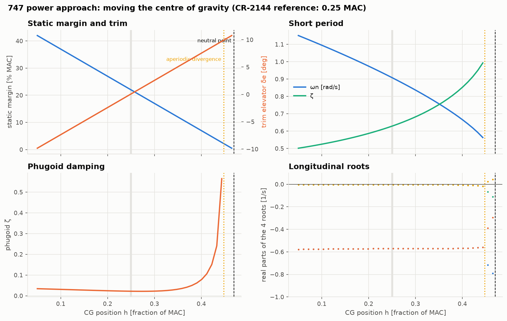
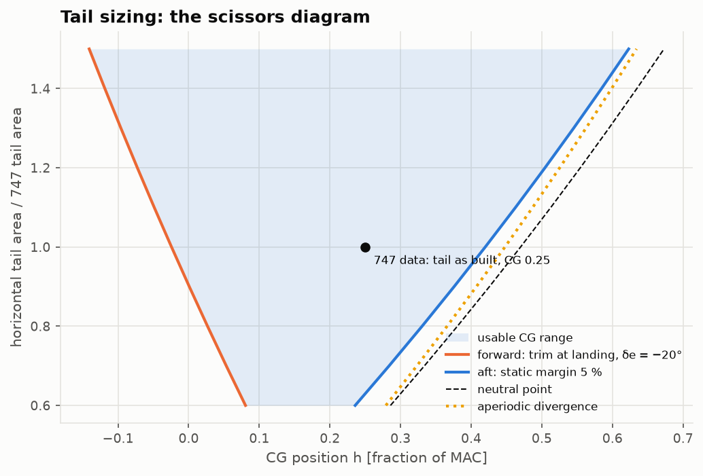
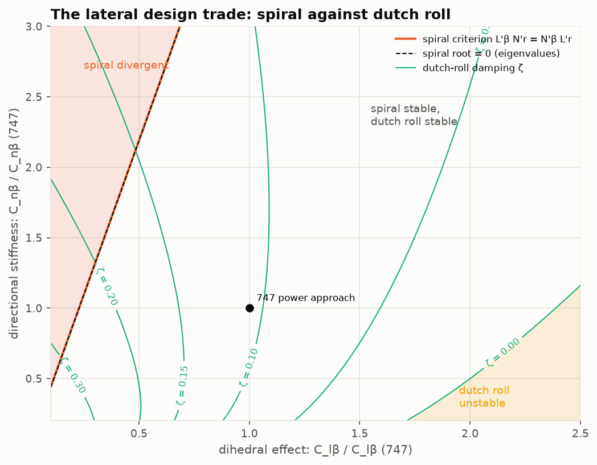

# Lesson 6 · Stability trade studies

> *Where the centre of gravity sits and how big the tail is are among the first decisions in
> an aircraft design, and among the hardest to undo. This lesson turns the model of Lessons
> 1–5 into a design tool: move the CG, resize the tail, rebalance the lateral derivatives,
> and watch the static margin and the modes respond.*

**Code:** [`src/flightdyn/trade_studies/`](../../src/flightdyn/trade_studies) ·
**Notebook:** [`06_trade_studies.ipynb`](../../notebooks/06_trade_studies.ipynb) ·
**Previous:** [Lesson 5 — Nonlinear simulation](05-nonlinear-simulation.md) ·
**Next:** [Lesson 7 — Verification and validation](07-verification-and-validation.md)

## Learning objectives

By the end of this lesson you should be able to

1. define the neutral point and static margin, and find them from the derivatives;
2. move the CG of a derivative model correctly, including the rate-derivative terms;
3. explain how CG position changes the short period and where the aircraft first diverges;
4. read a scissors diagram and explain what sets the forward and aft CG limits;
5. describe the lateral trade between spiral stability and dutch-roll damping.

---

## 1. Static stability and the neutral point

An aircraft is statically stable in pitch if a nose-up disturbance in angle of attack creates
a nose-down moment: $C_{m_{\alpha}} < 0$. Moving the CG aft by Δh mean chords moves the moment
reference behind the normal force, which adds $\Delta h C_{N}$ to the pitching moment
coefficient:

```math
C_{m_\alpha}(h) = C_{m_\alpha}(h_0) + (h - h_0)\,C_{N_\alpha}
```

The slope is linear in h, so it vanishes at one CG position, the **stick-fixed neutral point**
$h_n = h_0 - C_{m_{\alpha}}/C_{N_{\alpha}}$, and the **static margin** is the distance to it:

```math
K_n = h_n - h = -\frac{C_{m_\alpha}}{C_{N_\alpha}}
```



The figure shows the 747's aerodynamic $C_m(\alpha)$ for five CG positions. Ahead of the
neutral point (0.47 MAC) the lines slope down: stable. At the neutral point the line is
flat. Behind it the slope reverses, and any disturbance in α grows. At the published CG of
0.25 MAC the 747 has a static margin of 22 % MAC in the power approach.

## 2. Moving the CG properly

[`move_cg`](../../src/flightdyn/trade_studies/cg.py) re-expresses the whole derivative model
about a new CG. The textbook form (Etkin & Reid ch. 5) adds $\Delta h C_{N}$ to every
pitching-moment derivative, and notes that the old reference point, Δx ahead of the new CG,
moves at $\mathbf v + \boldsymbol\omega \times \Delta\mathbf x$. A pitch rate therefore changes its
angle of attack, and a yaw rate its sideslip:

```math
C_{L_q}' = C_{L_q} - 2\Delta h\,C_{L_\alpha}, \qquad
C_{m_q}' = C_{m_q} - 2\Delta h\,C_{m_\alpha} + \Delta h\,C_{N_q}', \qquad
C_{n_r}' = C_{n_r} + \frac{2\Delta x}{b}C_{n_\beta} + \ldots
```

Those formulas assume stability axes. In body axes at the 747's α0 = 8.5° the reference
velocity has a normal component $W_0 = V\sin\alpha_0$, so a pitch rate also changes the *speed*
of the old reference point, by $-q\Delta x\sin\alpha_0$. Dynamic pressure and Mach then change
at first order too, and since lift and drag are defined relative to the local velocity, which
turns slightly between the two points, $C_{L_q}$ and $C_{D_q}$ exchange $C_{D_0}$ and $C_{L_0}$
terms. The code includes all of these. The test is physical: the moved model must reproduce
the old model's force, and its moment plus $\mathbf r \times \mathbf F$, with an error that falls as
the *square* of the rates. With the textbook terms only, the error in normal force was first
order. That test found the missing terms.

## 3. What the CG does to the modes



Each point of this sweep is a full trim and numerical linearization of the nonlinear model
with the CG moved:

- **Trim elevator** moves trailing-edge-down as the CG moves aft (top left). The nose-heavy
  aircraft needs a tail download, the tail-heavy one an upload.
- **Short period** (top right): the frequency falls from 1.10 rad/s at 0.10 MAC to 0.56 rad/s
  near 0.44 MAC, roughly as $\sqrt{K_n}$, because static margin is the mode's spring. The damping
  ratio rises toward 1, since the damping ($C_{m_q}$) stays while the spring weakens.
- **Divergence** (bottom right): near 0.45 MAC the short-period pair splits into two real
  roots and one of them crosses zero. The aircraft then diverges without oscillating.

That crossing is at 0.448 MAC, **2.2 % MAC ahead of the neutral point**. The neutral point
measures stability in angle of attack at constant speed. A real root crossing zero is
stability with speed free to change. For this 747 the speed derivative $M_u$ is positive (the
thrust-moment trim of Lesson 3), so a speed increase pitches the nose up and the aircraft
loses speed stability slightly before it loses angle-of-attack stability. Mathematically, the
constant term of the longitudinal characteristic polynomial changes sign there (Etkin & Reid,
ch. 6). The phugoid is weakly damped everywhere (ζ ≈ 0.02). For some smaller tails it drifts
just past ζ = 0, a divergence so slow (doubling time of order 1000 s) that it is a
handling-qualities matter rather than a CG limit.

## 4. The horizontal tail, and the scissors diagram

To resize the tail, the model needs to know which part of each derivative comes from it.
Classical theory (Etkin & Reid ch. 2 and 5) gives the tail's contributions in terms of the
tail lift slope $a_t$, efficiency η, tail volume $V_H = S_t l_t/(S\bar c)$, downwash gradient
$\epsilon_\alpha$ and elevator effectiveness τ:

```math
C_{m_q}^{tail} = -2\eta a_t V_H\frac{l_t}{\bar c}, \qquad
C_{m_{\dot\alpha}}^{tail} = -2\eta a_t V_H\frac{l_t}{\bar c}\epsilon_\alpha, \qquad
C_{m_\alpha}^{tail} = -\eta a_t V_H(1 - \epsilon_\alpha), \qquad
C_{m_{\delta_e}} = -\eta\tau a_t V_H
```

[`HorizontalTail.calibrate`](../../src/flightdyn/trade_studies/tail.py) inverts them from
the published derivatives with **one assumption**: the tail arm, $l_t = 3.3\bar c$. Taking all of
$C_{m_{q}}$ as tail gives $\eta a_t V_H$ = 3.15. Then $\epsilon_\alpha = C_{m_{\dot\alpha}}/C_{m_q}$ =
0.15 and τ = 0.43. The tail supplies 0.81 of the 747's $C_{L_{\alpha}}$ of 5.70, and −2.67 of its
$C_{m_{\alpha}}$ of −1.26. So the wing and fuselage alone are unstable ($C_{m_{\alpha}}$ = +1.41), and
the tail turns the aircraft from unstable to strongly stable. Scaling the tail area by a
factor k adds (k − 1) times every tail contribution.



For each tail size the CG has two kinds of limit:

- **Aft**, set by stability: the neutral point, minus a margin (5 % MAC here). The aperiodic
  divergence of section 3 sits just ahead of the neutral point.
- **Forward**, set by control: the further forward the CG, the more nose-up moment the tail
  must make. Here the limit is where trim at the landing condition (CR-2144 fc 1) needs −20° of
  elevator. That limit is illustrative: the real 747 trims with a movable stabilizer.

Both lines move as the tail grows, the aft limit faster, so the usable range opens like a
pair of scissors. With the 747's tail it spans 44 % MAC. With 60 % of the tail it shrinks to
15 % MAC. A designer reads the diagram the other way round: pick the CG range the loading
needs, and the diagram gives the smallest tail that allows it. A smaller tail is lighter and
has less drag, which is why aircraft carry the smallest tail that meets both limits.

## 5. The lateral trade



Laterally, the two design knobs are the dihedral effect $C_{l_{\beta}}$ (wing dihedral and sweep)
and the directional stiffness $C_{n_{\beta}}$ (mostly fin size). The map scales the 747's values
of both and computes the lateral roots at every point.

- **Spiral divergence**, top left. Too much directional stiffness for the dihedral. The
  boundary computed from the eigenvalues coincides at every grid point with the classical
  criterion $L'_\beta N'_r = N'_\beta L'_r$, the constant term of the lateral characteristic
  polynomial (Lesson 4). At the 747's fin, the spiral would go divergent below 0.2 times its
  dihedral effect.
- **Dutch-roll damping** (contours) falls as dihedral grows and fin shrinks, and in the bottom
  right corner the dutch roll becomes unstable. Large dihedral effect makes sideslip roll the
  aircraft hard, and the roll couples back into yaw.

The 747 sits between the two, with ζ = 0.11 and a stable spiral. Swept-wing transports have
a large dihedral effect from sweep alone, which pushes them toward the low-damping side. That
is why most of them, the 747 included, fly with a yaw damper.

## 6. A link to the aerodynamics project

The derivatives come from tables, but a designer would estimate them from geometry. The
optional script [`validation/vlm_navion.py`](../../validation/vlm_navion.py) runs the Navion's
wing through the vortex-lattice solver of
[aerodynamics-from-scratch](https://github.com/GMCavalheri/aerodynamics-from-scratch). The
straight-tapered planform with Teper's span, area and mean chord (taper 0.41) gives a wing lift
slope of 4.40 per radian, against 4.44 for the whole aircraft, and an aerodynamic centre at
0.241 MAC, against the aircraft's neutral point at 0.447 MAC. The tail is what moves the
neutral point 0.21 MAC aft of the wing's aerodynamic centre: the same story the 747
calibration tells.

```bash
uv run --with "aero @ git+https://github.com/GMCavalheri/aerodynamics-from-scratch" python validation/vlm_navion.py
```

## 7. Common pitfalls

- **Moving the CG but not the rate derivatives.** $C_{m_q}$ changes with CG position, and in
  body axes at high α0 so do terms the textbook form drops.
- **Equating the neutral point with the stability boundary.** With speed effects ($M_u \ne 0$)
  the aircraft can diverge slightly ahead of the neutral point.
- **Sizing for one condition.** The forward limit comes from the slowest, most nose-heavy
  condition (landing), the aft limit from the least stable one. A scissors diagram combines
  conditions.
- **Over-trusting a calibrated tail.** The decomposition rests on the assumed tail arm and
  on all of $C_{m_{q}}$ being tail. It is a tool for trends, not for certification numbers.

## 8. Exercises

1. The 747 has $C_{m_{\alpha}}$ = −1.26 and $C_{N_{\alpha}}$ = 5.73 at a CG of 0.25 MAC. Find the
   neutral point and static margin.
2. Show that $C_{m_{\alpha}}$ is linear in CG position, and that moving the CG aft by 0.1 MAC
   reduces the static margin by exactly 0.1.
3. Using $\omega_{sp}^2 \approx -M_\alpha \propto K_n$, predict the short-period frequency at a static
   margin of 5 % from its value of 0.905 rad/s at 22 %. Compare with the sweep.
4. Why does a bigger tail move the forward CG limit forward as well as the aft limit aft?
5. From the lateral map, would you rather fix a divergent spiral with more dihedral or with a
   smaller fin? What does each do to the dutch roll?

<details>
<summary>Answers</summary>

1. $h_n$ = 0.25 + 1.26/5.73 = 0.47 MAC; $K_n$ = 0.22, or 22 % MAC.
2. $C_{m_\alpha}(h) = C_{m_\alpha}(h_0) + (h - h_0)C_{N_\alpha}$ is linear in h. Then
   $K_n = -C_{m_\alpha}/C_{N_\alpha}$ falls by exactly Δh.
3. ω ≈ 0.905 √(5/22) = 0.43 rad/s. The sweep gives about 0.6 rad/s at 0.42 MAC. The
   approximation neglects the $Z_w M_q$ term in the short-period stiffness, which does not
   depend on static margin and keeps the frequency up as $K_n$ → 0.
4. A bigger tail makes more pitching moment per degree of elevator ($C_{m_{\delta_e}}$ grows with
   $V_H$), so the elevator can hold a more nose-heavy aircraft.
5. More dihedral moves right on the map: the spiral stabilises, but the dutch-roll damping
   falls. A smaller fin moves down: the spiral stabilises too, the dutch-roll frequency falls
   and its damping changes little at first. Many designs take the fin size they need for
   engine-out control and fix the dutch roll with a yaw damper.

</details>

## Key takeaways

- The neutral point is where $C_{m_{\alpha}}$ vanishes. The static margin is the distance to
  it, and it sets the short-period stiffness.
- Moving the CG changes the rate derivatives too, and at nonzero α0 in body axes, through
  speed and dynamic-pressure terms the textbook form leaves out.
- With speed effects, the aircraft can diverge slightly before the neutral point.
- A scissors diagram turns stability (aft) and control (forward) limits into a tail size.
  Laterally, fin and dihedral trade spiral stability against dutch-roll damping.

## Further reading

- B. Etkin & L. D. Reid, *Dynamics of Flight*, 3rd ed., Ch. 2 (static stability, neutral point)
  and Ch. 5 (derivatives and the tail's contributions).
- R. C. Nelson, *Flight Stability and Automatic Control*, 2nd ed., Ch. 2–3.
- D. P. Raymer, *Aircraft Design: A Conceptual Approach*, Ch. 16 (tail sizing, CG limits).
