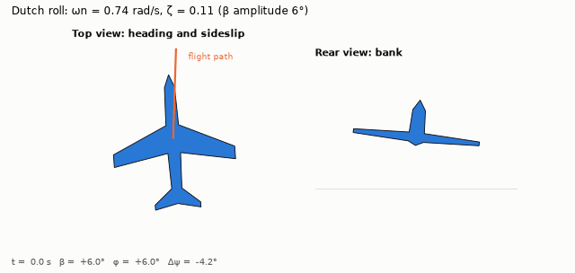
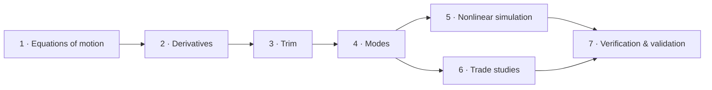

# Flight dynamics from scratch: the course

Seven lessons build a working flight-dynamics model from first principles. Each one derives
the theory, turns it into the code in this repository, and checks it against exact results or
published aircraft data. Each ends with exercises, answers included. The thread through the
course is the Boeing 747 of NASA CR-2144, with the Navion as a second, smaller aircraft.



## Lessons

| # | Lesson | You will learn | Key result |
|---|---|---|---|
| 1 | [The equations of motion of a rigid aircraft](01-equations-of-motion.md) | frames, Newton–Euler in body axes with $I_{xz}$, Euler angles, quaternions and gimbal lock | a tumbling body's CG still follows a parabola, to 1e-10 |
| 2 | [Aerodynamic derivatives](02-aerodynamic-derivatives.md) | the derivative model, stability vs body axes, dimensional and primed derivatives | the 747's own tables reproduced to 0.65 %, revealing its axis system and a Navion wing-area slip |
| 3 | [Trim](03-trim.md) | trim as root finding, climbs and coordinated turns, trim curves | "trimmed" 747 data includes the thrust moment: worth 4.5° of elevator |
| 4 | [Linearization and the classical modes](04-linearization-and-modes.md) | Jacobians two ways, the five modes, mode shapes, approximations | the Navion's roots to every printed digit; the 747's within 1.2 % at ten conditions |
| 5 | [Nonlinear simulation](05-nonlinear-simulation.md) | doublets, piecewise integration, the matrix pencil, error orders, coupling | linear error ∝ a² for elevator, a³ for rudder; modes read back to 0.08 % |
| 6 | [Stability trade studies](06-stability-trade-studies.md) | neutral point, exact CG transfer, tail sizing, the lateral trade | 22 % static margin; a scissors diagram; spiral against dutch roll |
| 7 | [Verification and validation](07-verification-and-validation.md) | check hierarchies, data vs assumption vs deduction vs calibration, rounding bands | what checking the reports against themselves found |



The lessons build on each other in order. Lesson 7 looks back at everything and can be read
at any point.

## Prerequisites

- Newtonian mechanics: rigid bodies, moments of inertia, rotating frames.
- Linear algebra and linear ODEs: eigenvalues, state space.
- Basic aerodynamics: lift, drag, pitching moment, lift-curve slope.
- Enough Python/NumPy to read a 50-line function.

## How to use it

1. **Read the lesson.** Every formula is derived or cited. Skip the derivations on a first pass
   if you like.
2. **Run the matching notebook** in [`notebooks/`](../../notebooks) and change the inputs.
3. **Open the code** linked at the top of each lesson. It is short and mirrors the equations.
4. **Do the exercises** before opening the answers. Every answer was computed with the code.

```bash
uv sync
uv run --with jupyterlab jupyter lab notebooks/
```

JupyterLab is not a project dependency. `--with` pulls it in for that command only.

## Figures

The teaching figures in [`docs/figures/lessons/`](../figures/lessons) are generated by
[`make_figures.py`](make_figures.py). The others, including the animations, are validation
figures from [`validation/`](../../validation).

```bash
uv run python docs/lessons/make_figures.py
```

## Data

The aircraft data comes from two public reports, transcribed with their table numbers in
[`validation/reference_data/`](../../validation/reference_data):
- R. K. Heffley & W. F. Jewell, *Aircraft Handling Qualities Data*, NASA CR-2144 (1972):
  Boeing 747;
- G. L. Teper, *Aircraft Stability and Control Data*, STI TR-176-1 (1969): Navion.

Everything that is assumed rather than published is labelled as an assumption.

## Reference texts

- B. Etkin & L. D. Reid, *Dynamics of Flight: Stability and Control*, 3rd ed. (Wiley, 1996): the
  main companion for Lessons 1–6.
- B. L. Stevens, F. L. Lewis & E. N. Johnson, *Aircraft Control and Simulation*, 3rd ed.
  (Wiley, 2016): Lessons 1, 3 and 5.
- R. C. Nelson, *Flight Stability and Automatic Control*, 2nd ed. (McGraw-Hill, 1998):
  Lessons 2–6.
- D. McRuer, I. Ashkenas & D. Graham, *Aircraft Dynamics and Automatic Control* (Princeton,
  1973): Lesson 4.
- W. L. Oberkampf & C. J. Roy, *Verification and Validation in Scientific Computing*: Lesson 7.
