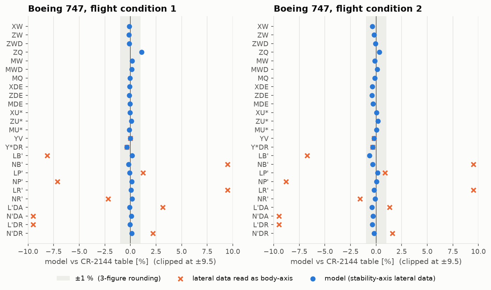
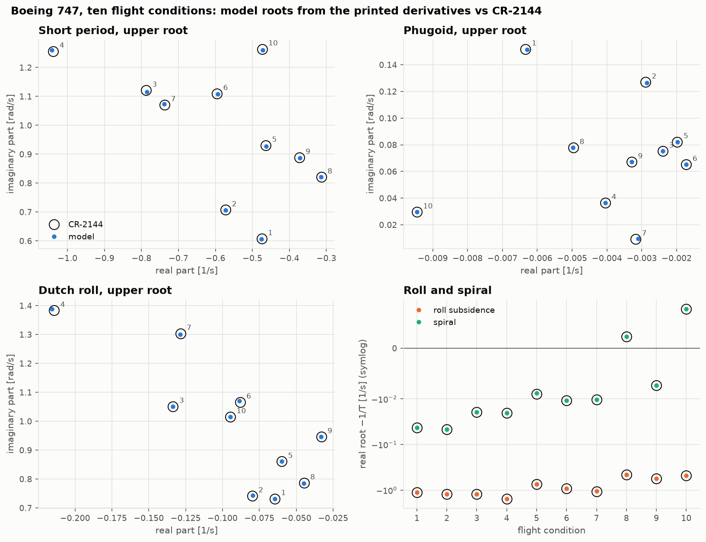
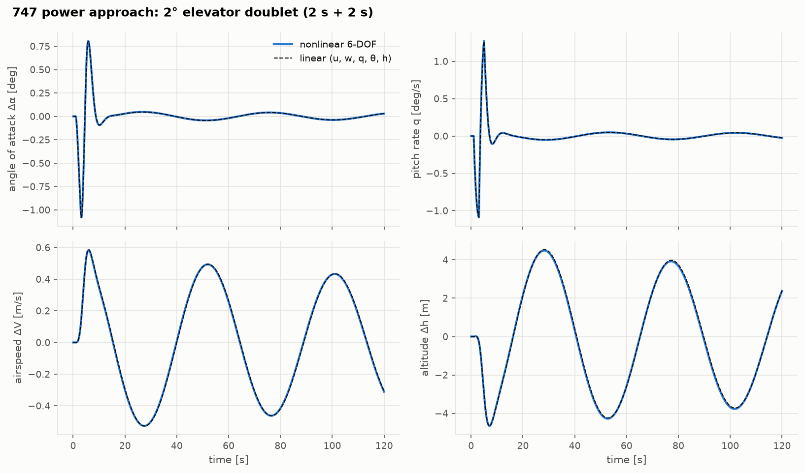

# Validation report

Every module in this repository is checked in one of two ways:
- **verification**: an exact identity, a closed-form result, or a second independent route to
  the same number;
- **validation**: published data for real aircraft, the **Boeing 747** (NASA CR-2144, ten
  flight conditions) and the **Navion** (Teper 1969).

The scripts in [`validation/`](../validation) (`uv run python validation/run_all.py`, about
45 s) produce every number below. They also write the figures in [`docs/figures/`](figures)
and the raw tables in [`validation/results/`](../validation/results). The same checks run as
`pytest` on every push.

## Data sources

Both reports are public (NASA Technical Reports Server). Every value used is transcribed in
[`validation/reference_data/`](../validation/reference_data) with its table, as printed:

| Source | What is used |
|---|---|
| **NASA CR-2144**, R. K. Heffley & W. F. Jewell, *Aircraft Handling Qualities Data* (1972), Section IX (NTRS 19730003312) | Boeing 747: geometry, weights, inertias and flight conditions (Table IX-3), nondimensional derivatives for landing and power approach (IX-1, IX-2), body-axis dimensional derivatives for ten conditions (IX-4, IX-8), published transfer-function denominators: phugoid, short period, spiral, roll, dutch roll (IX-5, IX-9); derivative definitions (Appendices A–C) |
| **STI TR-176-1**, G. L. Teper, *Aircraft Stability and Control Data* (1969), Section X (NTRS 19690022405) | Navion: geometry and mass (X-A), nondimensional derivatives (X-B, X-C), dimensional derivatives (X-D, X-E), published roots (X-F, X-G) |
| **US Standard Atmosphere 1976** | ISA definition and table values |
| Textbooks (Etkin & Reid; Stevens, Lewis & Johnson; Nelson) | closed forms, cited at chapter level |

Internal-consistency tests on the transcription ([`tests/test_reference_data.py`](../tests/test_reference_data.py))
tie printed numbers together through their definitions (dynamic pressure, Mach, thrust
derivatives, $C_L = W/(qS)$).

## Scorecard

| Module | Check | Result | Reference |
|---|---|---|---|
| Rigid body | torque-free precession, ballistic parabola while tumbling | 7e-10, 4e-10 | closed form |
| Rigid body | momentum and energy conservation with $I_{xz}$; Euler vs quaternion | ≤ 1e-8 | exact |
| Derivatives | Appendix A/B formulas vs finite differences of the force model | ≤ 1e-6 | exact |
| **747 derivatives** | nondimensional → dimensional vs CR-2144 Tables IX-4, IX-8 (fc 1, 2) | **≤ 0.65 %** (Z_q 1.1 %) | CR-2144 |
| Trim | level, climb, descent vs independent wind-axis solution | 1e-10 rad | exact |
| Trim | coordinated turn vs inertial centripetal balance | 1e-12 | exact |
| Linearization | numerical vs analytic Jacobians | 2e-8 relative | exact |
| Linearization | eigenvalues in body vs stability axes | 1e-10 | exact |
| **Navion modes** | printed derivatives → roots vs Teper Tables X-F, X-G | **≤ 0.11 %** (every printed digit) | Teper |
| **747 modes** | printed derivatives → roots vs CR-2144 Tables IX-5, IX-9, ten conditions | **≤ 1.2 %** (two cases within their rounding band) | CR-2144 |
| **747 modes** | nondimensional data → roots at the reference, fc 1 and 2 | **≤ 1.2 %** | CR-2144 |
| Simulation | linear simulation vs matrix exponential | 1e-10 | exact |
| Simulation | nonlinear − linear error order, elevator / rudder | a², a³ (ratio 4.0, 8.0) | Taylor series + symmetry |
| Simulation | poles identified from nonlinear time histories vs eigenvalues | ≤ 0.08 % | linear model with altitude |
| Trade studies | CG transfer vs rigid-body transfer | second order in the rates | exact |
| Trade studies | spiral boundary vs $L'_\beta N'_r = N'_\beta L'_r$ | every grid point | Etkin & Reid ch. 8 |

## 1. Rigid-body equations of motion

Verification only: the dynamics have closed-form solutions for special motions
([theory note](equations_of_motion.md), [tests](../tests/test_equations_of_motion.py)). The
strongest check is the ballistic one: a body tumbling about all three axes must still move its
CG along a parabola, which exercises gravity, the transport terms and the direction cosine
matrix together.

## 2. Aerodynamic derivatives



The 747's nondimensional derivatives, run through CR-2144's own Appendix A formulas, reproduce
its dimensional derivatives within 0.65 % — the rounding of three printed figures — once two
things in the report are understood ([results](../validation/results/derivative_validation.md)):

- **The lateral derivatives are stability-axis.** Tables IX-1 and IX-2 do not say. Read as
  body-axis derivatives they miss Table IX-8 by up to 115 %.
- **The data is trimmed with the thrust moment.** $M_u^{\ast}$ and $M_w$ contain the reference
  $C_m$. With $C_{m_0}$ = 0 they are 1.6–3 times and 1.7 % off; with the aerodynamic $C_{m_0}$ that
  balances the published thrust line ($-Tl_{th}/(qS\bar c)$ = −0.096 at fc 1, −0.037 at fc 2)
  they agree to 0.1–0.2 %. The model uses that deduced $C_{m_0}$, labelled as such.

$Z_q$ is the one remaining exception (1.1 % at fc 1): the table equals the formula with $U_0$ in
place of V.

**Navion.** Every dimensional derivative in Teper's Table X-D/X-E is 2.22 % (moments) or 2.31 %
(forces) larger than Tables X-A to X-C imply. The ratio is 184/180: the dimensional table was
computed with a wing area of 184 ft², the geometry table prints 180 ft². The force derivatives
carry an extra 0.08 % from the printed mass (85.4 slug against W/g = 85.47).

## 3. Trim

Verified against an independent scalar wind-axis solution (level, climb, descent), the
inertial centripetal balance of a coordinated turn, and 20 s of nonlinear flight that does not
move ([theory note](trim.md)). At the 747's published conditions the model trims within 0.44°
of α0 with under 0.5° of elevator. The remaining α offset equals the lift of the inclined
thrust, which the tabulated $C_L = W/(qS)$ does not count; the test checks that identity.

## 4. Linearization and the classical modes



Three routes, each against the published roots ([results](../validation/results/mode_validation.md)):

1. **Printed dimensional derivatives → roots.** The Navion matches every printed digit
   (≤ 0.11 %). The 747 matches within 1.2 % at all ten conditions, except fc 5's spiral
   (1.8 %) and fc 7's nearly critically damped phugoid; a Monte Carlo over the rounding of the
   printed derivatives shows both inside the spread rounding alone produces.
2. **Nondimensional data → roots at the reference** (747 fc 1 and 2): within 1.2 % for every
   mode. The nondimensional data, the Appendix A formulas and the model's $\dot\alpha$ and q terms
   are consistent.
3. **Nonlinear model → trim → numerical linearization.** Short period, roll and dutch-roll
   frequency within 0.5 %; phugoid damping 4–10 % low and dutch-roll damping up to 5 % low,
   because the model trims 0.1–0.4° below α0 (section 3). The Navion's 1–2 % offsets come from
   Teper's 184 ft².

Route 1 needed one discovery. CR-2144's Appendix C says the $\dot u$ terms of the $\dot\alpha$
effect are neglected, and its tables print no $X_q$. Built that way, the model misses the
published phugoid damping by 7–9 % at fc 1 and 2, well outside the rounding band. Adding
$Z_{\dot u} = -(W_0/U_0)Z_{\dot w}$, $M_{\dot u} = -(W_0/U_0)M_{\dot w}$ and $X_q = -\tan\alpha_0 Z_q/\cos\alpha_0$, each
derived from printed values, brings all ten conditions within 1.1 %: the published numbers were
computed with them.

The classical approximations, applied in stability axes, are good for the short period (2.4 %)
and the Navion's roll (0.4 %), and poor for the 747's phugoid, spiral and dutch-roll damping
(off by 35 % to a factor of 3) — strong roll coupling and the positive $M_u$ are outside their assumptions.

## 5. Nonlinear simulation



Doublet responses of the nonlinear model and its linearization overlay at small amplitude.
The difference grows as amplitude² for elevator inputs and amplitude³ for rudder inputs: mirror
symmetry makes the lateral states odd functions of a lateral input
([results](../validation/results/simulation_validation.md)). Poles extracted from the nonlinear
time histories by the matrix pencil method, without any model, equal the linear eigenvalues
to 0.08 % — once altitude is a state of the linear model. The 4-state phugoid is 1.6 % slow
because it ignores the density gradient the aircraft flies through.

## 6. Trade studies

Verification: the CG transfer reproduces the rigid-body transfer of force and moment with a
residual second order in the rates; the spiral boundary of the lateral map equals the
classical criterion at every grid point. Results, with their stated assumptions (tail arm,
elevator limit, minimum margin), are in the [results table](../validation/results/trade_studies.md):
neutral point 0.470 MAC (static margin 22 % at the published CG), aperiodic divergence 2.2 %
MAC ahead of it, usable CG range 44 % MAC.

The optional cross-check with the vortex-lattice solver of
[aerodynamics-from-scratch](https://github.com/GMCavalheri/aerodynamics-from-scratch)
([results](../validation/results/vlm_navion.md)) gives the Navion wing a lift slope of 4.40 per
radian, against 4.44 for the whole aircraft, and an aerodynamic centre at 0.241 MAC, 0.21 MAC
ahead of the aircraft's neutral point.

## 7. What validation caught

**In the reference data** (kept as printed; the tests document each):

1. The 747's lateral derivatives (Tables IX-1/2) are stability-axis; the tables do not say so.
2. The 747's derivatives were evaluated with the thrust moment trimmed out ($C_{m_0} \ne 0$),
   which only the dimensional derivatives reveal.
3. CR-2144's published roots include the $\dot u$ terms and $X_q$ that its Appendix C says are
   neglected.
4. CR-2144's $Z_q$ uses $U_0$ where the derivation gives V.
5. Teper's Navion dimensional derivatives use S = 184 ft²; the geometry table prints 180 ft².
6. CR-2144 prints dynamic pressures at fc 9 and 10 about 1.1 % above $\rho V^2/2$.

**In this model and its documentation** (all fixed and tested):

1. A first reading of $M_w$ as a sign slip in the report was wrong. The $M_u^{\ast}$ mismatch,
   examined together with it, showed the real cause: the thrust-moment trim.
2. The CG transfer at first lacked the body-axis speed terms (at α0 ≠ 0 a pitch rate changes the
   speed of the old reference point) and the lift–drag rotation terms. The rigid-body transfer
   test showed a first-order residual in normal force; with the terms it is second order.
3. Linearizing at sea level failed: a downward altitude perturbation left the ISA's range. The
   ISA now extends to −5 km, as the US 1976 tables do.
4. Comparisons of linear and nonlinear responses first plotted body-axis Δu as airspeed; at
   α0 = 5.6° the projection matters.
5. The classical mode approximations were first fed body-axis derivatives; they assume
   stability axes, and `to_stability_axes` now provides them.
6. A "first unstable root" CG limit picked up the marginally damped phugoid, which crosses
   ζ = 0 with doubling times of order 1000 s. The trade study now uses aperiodic divergence.
7. A lesson stated that a doublet's spectrum peaks at 1/(2T); it peaks at ω ≈ 2.33/T.

## Reproducing everything

```bash
uv sync
uv run pytest
uv run python validation/run_all.py
uv run python notebooks/build_notebooks.py
uv run python docs/lessons/make_figures.py
```

All outputs — PNG figures, GIF animations and executed notebooks — are byte-identical on
rebuild. The optional AERO-01 cross-check runs with
`uv run --with "aero @ git+https://github.com/GMCavalheri/aerodynamics-from-scratch" python validation/vlm_navion.py`.
